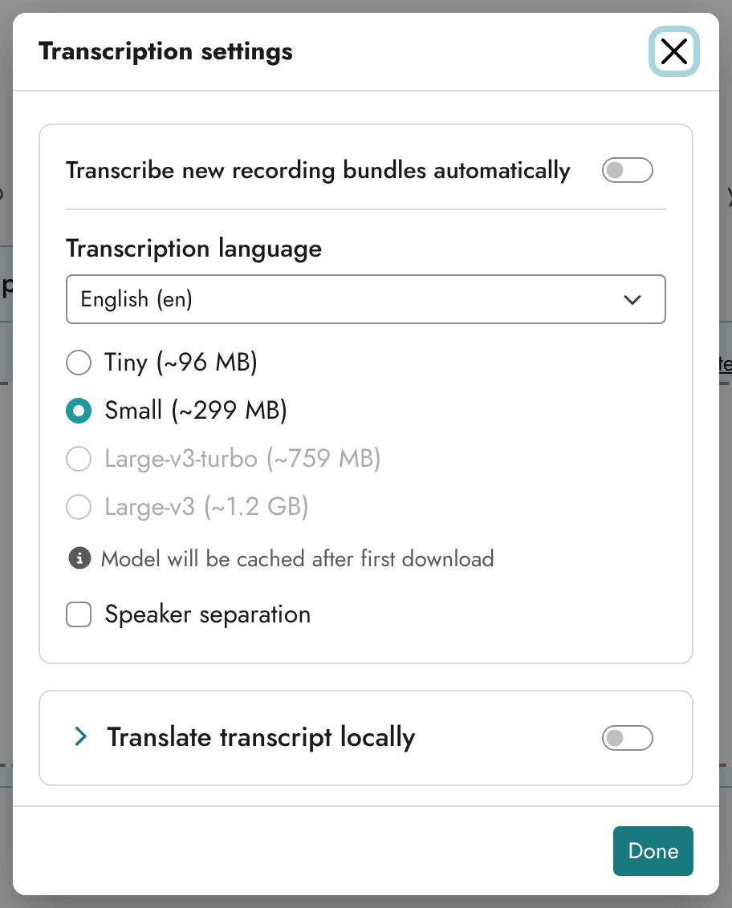

# Automatic draft transcription

Tratt can run a speech-recognition model **on your own computer, inside the browser
tab**, and open the result in the editor for you to revise. It can also make an initial 
guess on who in a conversation said each utterance, and the interface also allows a
rough translation of the draft transcription to be made.

All three automatic annotation procedures produces draft annotations. The user should 
be prepared to make revisions to the draft annotation later.

---

## Turning it on

**It is already on.** Adding a recording is the instruction: Tratt queues it and a
speech-recognition model writes a draft. You only need this page when you want to
change what the model is told, or to stop it running at all.

The controls are in one dialog, **Transcription settings**. Open it with
**Change**, next to *Transcription language* on the empty start page, or with the
sliders button beside **Transcribe** once recordings are in the list.

1. **Transcribe new recording bundles automatically**: the switch at the top.
   Turn it off and recordings sit in the list untouched until you press
   **Transcribe**.
2. **Transcription language**: the language actually spoken on the recording.
   A hundred languages are offered, listed by their own names
   (*Svenska (Swedish, sv)*, *Suomi (Finnish, fi)*), with Swedish first and the rest
   alphabetical. Tratt preselects the language your interface is set to, so change
   it if the recording is in something else. This is not a translation setting.
3. **Model**: see the tables below. The list changes with the language.
4. **Speaker separation** (optional): see [Speaker separation](#speaker-separation).
5. **Translate transcript locally**: a second section, folded away until you open
   it. See [Translating the transcript](#translating-the-transcript).

**Done** closes the dialog and keeps what you chose, for this recording and the
next one.

To add a recording *without* running a model, use **Transcribe by hand, without
AI** under the drop area on the start page.

While a recording runs, its row in the list names the stage it has reached:
**Preparing**, **Loading model**, **Transcribing**, **Separating speakers**,
**Translating**. The button on the row stops that one recording.

### Keep the tab open

The work happens in this tab. Do not close it, and be careful with laptop sleep on
long recordings. Switching to another tab is fine; the transcription keeps running,
though some browsers slow background tabs down.

---

## Which model to pick

The model list changes with the language you chose, because Tratt ships specialised
models for the Nordic languages.

**If your machine has WebGPU** (recent Chrome, Edge or Firefox with a reasonable
graphics card), all models are available and the larger ones are much faster.
**Without WebGPU** the models run on the CPU instead: the ones that need it are
greyed out in the list and cannot be picked, and the rest are slow but usable.

### Swedish

Uses **KB-Whisper** from the National Library of Sweden, trained on Swedish speech.
Noticeably better than the general model for Swedish.

| Model | Roughly | Notes |
| --- | --- | --- |
| Tiny | 120 MB | Fastest, least accurate. Good for checking that the pipeline works. |
| Small | 400 MB | Reasonable compromise |

> **These two figures are the CPU build.** Tiny and Small are the only models
> Tratt fetches in two quantisations: a smaller 4-bit build on a machine with
> WebGPU, and a larger 8-bit one without. The interface shows the larger number
> either way, so with WebGPU the download is appreciably smaller than it says.
> Every other model on this page is the same 4-bit build on both paths, and its
> figure is exact.
| Medium | 1000 MB | More accurate again. Needs WebGPU. |
| Large | 1200 MB | Most accurate, about half the speed of Medium. Needs WebGPU. |

### Finnish and Norwegian

Also fine-tuned models. Finnish offers Tiny (about 108 MB), Medium (about
684 MB) and Large (about 1210 MB); Norwegian has its own models too, including a
verbatim one that writes what was said rather than tidying it up. Everything
above Tiny needs WebGPU.

### Sami

Northern, Lule and Southern Sami have their own fine-tuned models. They are
Large only (about 1210 MB), so they need WebGPU; on a machine without it the
language can be chosen but no model can.

### Every other language

Uses OpenAI's Whisper.

| Model | Roughly | Notes |
| --- | --- | --- |
| Tiny | 95 MB | Fastest, least accurate |
| Small | 290 MB | **Preselected.** A reasonable compromise. |
| Large-v3-turbo | 700 MB | Fast and accurate. Needs WebGPU. |
| Large-v3 | 1200 MB | Slower than Turbo, often a little more accurate. Needs WebGPU. |

Tratt preselects Small. If your machine has WebGPU and the recording matters,
switch to **Large-v3-turbo**.

### About the download

The model comes from `huggingface.co` the first time you use it and is then cached
in your browser, so the second run starts immediately. Your audio is never sent
anywhere; see [What leaves your computer](privacy.md).

If the download is interrupted, retry; if it keeps failing, the network is blocking
`huggingface.co` and automatic transcription will not be available on that machine.

---

## Speaker separation

Ticking **Speaker separation** runs a second model that divides the recording by
speaker and labels each transcription unit with a speaker ID.

- Leave **Expected number of speakers** blank to let it guess.
- Set it if you know: `2` for a typical interview. Giving the real number usually
  produces a cleaner result than auto-detection.

This model runs on the CPU regardless of WebGPU, so it adds time. Allow for
noticeably longer processing on a long recording.

The result is a starting point, not a finding. Speakers who sound alike, crosstalk
and background voices all confuse it. You can fix labels afterwards: see
[Tiers and speakers](tiers-and-speakers.md#fixing-speaker-labels).

---

## Translating the transcript

Tratt can also translate, locally, using Opus-MT models.

**On the start page.** Once there is a transcript to work with, either one you
loaded or one auto-transcription is about to produce, a **Translate transcript
locally** box appears. Pick **From** (about thirty languages) and **To**. The
**To** list only offers languages actually reachable from your source, and marks
routes that have to go through English as *(two steps)*. Tratt then tells you which
path it will use:

- *One-step download*: one model, straight from your language to the target.
- *Two-step download (via English)*: no direct model exists, so it goes through
  English. Two models to fetch, slower to run, and quality suffers a little.
- *No local translation model found for this language pair*: that pair is not
  possible.

Translation runs on your machine and can take several minutes. If it stops making
progress Tratt says so rather than leaving you guessing: *Model load stalled*,
*Translation stalled, no progress for 60 seconds*, or *Download stalled, likely a
browser storage limit*, which is the one to retry with **Skip browser cache**
ticked.

**While working.** In the editor, the tier menu offers **Add translated tier…**,
which creates a linked tier whose boundaries stay in sync with the source tier, and
**Translate linked tier**, which fills in the empty segments. Translations you have
edited by hand are never overwritten. See
[Tiers and speakers](tiers-and-speakers.md).

**Skip browser cache.** A checkbox in the options. Some browsers hit storage quota
limits when caching large models and freeze. Ticking this bypasses the cache: the
model is re-downloaded every time, but the freeze goes away. Use it only if you hit
the problem.

---

## When it is not available

**Safari and other WebKit browsers.** The checkbox is disabled with a warning. The
models are large enough to make Safari reload the tab mid-download, which loses your
work. Use Chrome, Edge or Firefox for automatic transcription. Manual transcription
in Safari is fine.

**No WebGPU.** The models that need it are greyed out with the note *Requires
WebGPU*; which ones those are depends on the language. The smaller models still
work.

**Errors.** If transcription fails while running on WebGPU, the error box suggests
retrying without it. Tratt detects WebGPU automatically and has no switch of its
own, so the way to force the slower, more tolerant CPU path is to turn WebGPU off
in the browser itself (in Chrome and Edge: `chrome://flags` → *Unsafe WebGPU
Support* / *WebGPU* → **Disabled**, then restart) and reload Tratt. All models then
run on WASM, and the largest ones become unavailable. More in
[Troubleshooting](troubleshooting.md).
