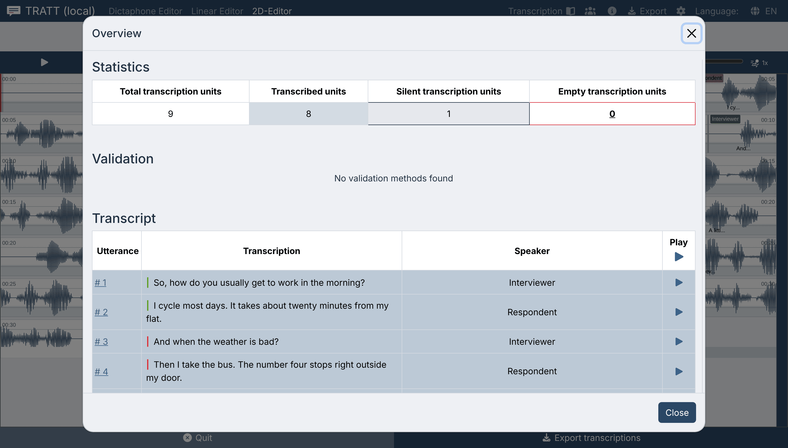

# Checking your work

**For:** the transcriber, at the point where the file is "basically done".

---

## The Overview window

Press **Alt + 0**, or click **Overview** in the toolbar under the header (in the Workbench, in the bar with the editor tabs).

It has three parts.

### Statistics

| Column | Means |
| --- | --- |
| **Total transcription units** | How many units the current tier has |
| **Transcribed units** | Units with text in them |
| **Silent transcription units** | Units marked as a break (`
`) |
| **Empty transcription units** | Units with neither text nor a break: your remaining work |

Aim for **Empty transcription units = 0** before you export. If the number is not
zero, click it: Tratt highlights what is missing.

### Validation

If the project's guidelines file names a validation script, this section lists each
tier with its error count (normally *No errors found*) and offending text is
underlined in the editor. If no validation is configured, the section reads
*No validation methods found* instead. Either is normal; the standard Tratt
guidelines carry only spelling and punctuation rules, so in practice this section
rarely tells you anything.

### Transcript

Every unit as a table row: number, text, speaker (when the transcript has speakers),
and a **Play segment** button. The ▶ in the column header is **Toggle play all**,
which plays the units in sequence.

This table is editable. Click a row and the text field opens inline, complete with
the marker toolbar. For a final read-through this is often faster than stepping
through the waveform, because you can read continuously and only stop where
something looks wrong. Click ▶ on the suspicious row, fix it, move on.

### Verified transcriptions

Automatic transcription starts out **unverified**. Each sentence carries a coloured
bar at the start of its line: **orange** until a human has checked it, **green**
once it is verified. A transcription becomes verified when you

- listen to its part of the recording (playing the segment — in any editor, or
  via **Toggle play all** in the Overview — counts after 200 ms of
  actual playback inside that unit), or
- edit its text yourself.

Manually typed transcriptions count as verified from the start. The same green
and orange bars prefix every sentence in the exported [Word document](exporting.md).

Three rules catch people out:

- **Listening marks only the tier you are viewing.** Playing the recording while
  the source tier is selected does not verify the units of a translation tier;
  switch tiers and listen again.
- **Hover previews do not count.** Moving the pointer over the waveform plays short
  scrub snippets; only real playback (Tab, ▶, **Toggle play all**) verifies.
- **A transcript imported without `⍻` marks arrives fully verified.** An SRT or
  ELAN file from another tool has no such marks, so every unit is green from the
  first moment even though nobody here has checked it. See
  [verification marks](exporting.md#verification-marks).

---

## Guidelines

**Alt + 9**, or **Guidelines** in the toolbar, opens the transcription conventions
for the project: spelling and punctuation rules, and the meaning of every marker
with examples.

The default Tratt guidelines are deliberately thin (correct spelling, no
punctuation characters) because they are meant to be replaced. If your project has
its own conventions, they belong in the guidelines file so that they are one
keystroke away for everyone working on the material, rather than in a document
nobody opens.

---

## A last-pass checklist

1. **Alt + 0** → *Empty transcription units* is 0.
2. Skim the transcript table top to bottom. Numbers, names and places are where
   automatic transcription is weakest, so check those against the audio specifically.
3. If you used speaker separation, check the speaker column at the points where the
   conversation changes pace; that is where the model tends to switch too late or
   too early.
4. Check that unclear passages are marked (`**`) rather than guessed.
5. [Export](exporting.md), and export **AnnotJSON** as well as your working format,
   so a later correction does not mean starting over.
