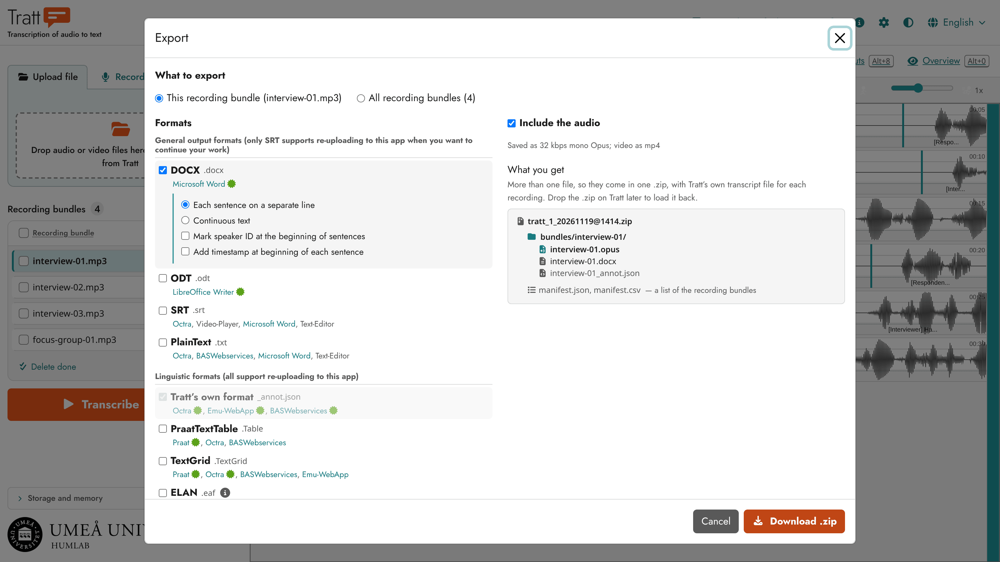

# Exporting

**For:** everyone, at the end of every session.

Tratt keeps your work in the browser. **Exporting a file is the only
way your transcript leaves the browser.** Export your work everytime you exit an editing session.

In the [Workbench](workbench.md), click **Export…** under the list of recording
bundles. (Where Tratt has no list, it is **Export**, the download icon in the
header.) The dialog is headed *Export*:

1. **What to export**: *This recording bundle* (the one open in the editor),
   *The ticked recording bundles*, or *All recording bundles*. It starts on the
   ticked ones when you have ticked any, and is not shown when there is only one
   recording.
2. **Formats**: tick one or more. A ticked format shows its
   [options](#options) underneath.
3. **Include the audio**: puts each recording's audio next to its transcripts.
   It is ticked to begin with whenever audio is attached, and only offered then.
   Audio is saved as 32 kbps mono Opus (`.opus`); video as `.mp4`, with the
   video untouched.
4. **What you get** shows the result before you download it, file by file.
5. **Download**.

**One file or a .zip.** When your choices make exactly one file, for example one
recording's audio alone, it downloads as that file. Anything more (several formats,
several recordings, the audio, or a one-tier format for a recording with several
tiers) comes as one `.zip`; see [Exporting an archive](#exporting-an-archive).
The button says which: **Download** or **Download .zip**.

Tratt remembers the formats you ticked for the next export.

---

## Which format to export to?

The dialog groups formats into three sections, and tells you for each group whether
you can load the file back into Tratt later.

### General output formats

For reading, sharing and publishing. **Only SRT can be loaded back into Tratt.**

| Format | File | Good for |
| --- | --- | --- |
| **DOCX** | `.docx` | MS Word. The format most people actually want the transcript in. |
| **ODT** | `.odt` | LibreOffice / OpenOffice. Same options as DOCX. |
| **SRT** | `.srt` | Subtitles, video players, and the one format in this group you can re-import to continue your work later|
| **PlainText** | `.txt` | Anything that reads text |

### Linguistic formats

All of these can be loaded back into Tratt.

| Format | File | Good for |
| --- | --- | --- |
| **Tratt's own format** (AnnotJSON) | `_annot.json` | Emu SDMS compliant. Keeps everything: tiers, boundaries, speakers, and markers. Always included; it cannot be unticked. |
| **TextGrid** | `.TextGrid` | Praat's primary annotation file format |
| **ELAN** | `.eaf` | ELAN. Put the `.eaf` in the same folder as the audio or ELAN will not find the media. |
| **PraatTextTable** | `.Table` | Praat's table format |

### Specialist technical formats

| Format | File | Good for |
| --- | --- | --- |
| **WebVTT** | `.vtt` | Web video subtitles |
| **BASPartitur** | `.par` | BAS web services. Export writes ORT and TRN lines from the transcription. |
| **CTM** | `.ctm` | Speech-recognition scoring tools. Confidence is always written as 1; Tratt does not track it. |

> **Keep Tratt's own format.** DOCX and ODT are one-way: they read well and
> import badly. If you might need to correct the transcript in six months, Tratt's
> own file plus the original recording is what lets you. It is always
> included in the export and cannot be unticked.

---

## Options

### DOCX and ODT

| Option | Effect |
| --- | --- |
| **Each sentence on a separate line** / **Continuous text** | One transcription unit per line, or everything run together as prose |
| **Mark speaker ID at the beginning of sentences** | Prefixes each unit with its speaker as a voice tag, `<v Name>`. The same tag is read back on import (the older `[Name]` form is still recognised). WebVTT always writes the tag. |
| **Add timestamp at beginning of each sentence** | Prefixes each unit with its start time |
| **Collect annotations according to transcription tier in the output** | Shown when a recording has more than one tier: groups the output tier by tier instead of interleaving |

Each sentence starts with a coloured bar in the exported Word (DOCX) and ODT
documents, and a one-line key under the acknowledgement explains the colours: a **green**
`|` marks a transcription you have verified (listened to its part of the
recording, or edited the text), an **orange** `|` marks one that still only
holds the automatic transcription.

### Verification marks in time-aligned formats

The time-aligned export formats (SRT, WebVTT, ELAN, TextGrid, PraatTable,
CTM, BAS Partitur, Whisper JSON) carry the verification state in the text
itself: every non-verified transcription ends with a **not-check mark**
(`⍻`, U+237B). Verified sentences are written without it. When you load such
a file together with its audio later, Tratt reads the mark back. Marked
sentences come in as non-verified, unmarked ones as verified.

### Plain text

| Option | Effect |
| --- | --- |
| **Mark speaker ID at the beginning of sentences** | As above |
| **Add a line break after each transcription unit** | One unit per line |
| **Separate transcription units by readable timestamps (HH:MM:SS.s)** | Human-readable times between units |
| **Separate transcription units by sample points** | Sample positions between units, for lining up against the signal elsewhere |
| **Collect annotations according to transcription tier in the output** | Shown when a recording has more than one tier |

Ticking both time options inserts both.

### SubRip and WebVTT

| Option | Effect |
| --- | --- |
| **Move units with speaker label to separate levels** | One tier per speaker instead of one mixed tier |
| **Combine empty units with max duration (ms) between units of the same speaker** *(SRT)* | Merges a short gap between two turns by the same person. Blank switches it off. |

### Tiers

Every tier is exported; there is nothing to choose. This only matters when a
transcript has more than one tier, for example a translation.

- **Tratt's own format, TextGrid, Praat Table, ELAN** carry several tiers natively:
  one file with all of them.
- **DOCX, ODT and plain text** put all tiers in one file. The *Collect annotations
  according to transcription tier* option decides whether they are grouped tier
  by tier or interleaved.
- **SubRip, WebVTT, BAS Partitur, CTM** hold one tier, so they write one file per
  tier, named after it: `interview-Transcript.srt` and
  `interview-Swedish (sv).srt`. With more than one file, the export comes as a
  `.zip`.

### Meta data

When you export the recording bundle open in the editor, the dialog also offers,
under *More for this transcript*, the meta data logged while you worked
(**Protocol**). It is only available if **Log user actions** was on in
Preferences. It is a research artefact (keystroke and playback history), not part
of the transcript.

---

## Exporting an archive

When an export makes more than one file, Tratt packs them into one `.zip`
archive. It is the only export that can be loaded back complete: one archive can
hold a whole batch of recording bundles.

The file is named after what is in it and when it was made, for example
`tratt_12_20261008@1923.zip`, wich means that the archieve contains twelve recordings, and was written on the October 8th, 2026, at 19:23 local time.

Inside the archive, each recording has its own folder under `bundles/` holding

- the **audio** (32 kbps mono Opus; video as `.mp4`), when **Include the audio** was ticked. If Tratt cannot convert a file, it exports the original and warns you,
- **Tratt's own file** (`_annot.json`) of its transcript, always, and
- the formats you ticked.

Two manifests files are located at the root of the archiive: **`manifest.json`** and **`manifest.csv`**. These files list every
recording with its paths and details. The CSV opens in a spreadsheet, which makes
it a convenient index for a corpus.

Because the audio and Tratt's own file are bundled together, dropping the archive back on
the drop zone restores the whole batch, audio attached and transcripts in place.
Loading it switches automatic transcription off so your corrections are not
overwritten. See [The Workbench](workbench.md#loading-an-archive).

A recording bundle whose audio was not attached at export time has no audio file in the
archive, only its transcript; the export dialog says how many that applies to
before you download. Dropping the archive loads that transcript into the
recording bundle of the same name already in the list (attach the audio there). 
Tratt indicates which ones failed to be loaded by showing *Completed with warnings* rather than
failing the whole export.

---

## Formats Tratt can read

Drop these alongside your audio on the start page to continue existing work.

| Format | Notes |
| --- | --- |
| **Tratt archive** (`.zip`) | A whole session, audio and transcripts together. See [Exporting an archive](#exporting-an-archive). |
| **AnnotJSON** (`_annot.json`) | Complete description of the transcript for one recording. |
| **WhisperJSON** (`.json`) | Output from Whisper / WhisperX run elsewhere. Only timestamps and text are read; everything else is ignored. |
| **SubRip** (`.srt`) | With speaker-extraction options; see [Tiers and speakers](tiers-and-speakers.md#importing-material-that-already-has-speakers) |
| **WebVTT** (`.vtt`) | Reads `<v Name>` voice tags. STYLE, REGION and NOTE blocks are ignored; multi-line cues are merged. |
| **Plain text** (`.txt`) | |
| **TextGrid** (`.TextGrid`), **Praat Table** (`.Table`) | |
| **ELAN** (`.eaf`) | Only the tier attribute `ANNOTATION` is parsed |
| **BAS Partitur** (`.par`) | TRN and ORT lines are combined into one tier of time-aligned units |
| **CTM** (`.ctm`) | |

The transcript file's name must match the audio file's name, or Tratt rejects it
with *Transcript filename does not match the audio filename*.

DOCX and ODT files cannot be imported into Tratt.

---

## Custom tables

If none of the above has the columns you need, build your own with the
**Table-Configurator**, under *More for this transcript* at the bottom of the
export dialog when you export the recording bundle open in the editor. See
[Tools → The Table Configurator](using-tools.md#table-configurator).
