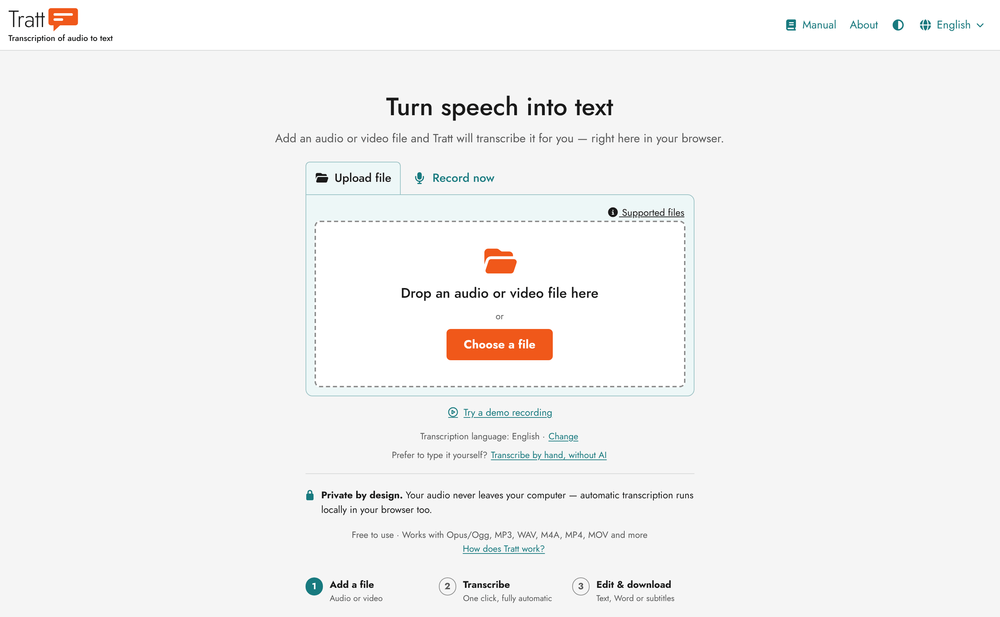
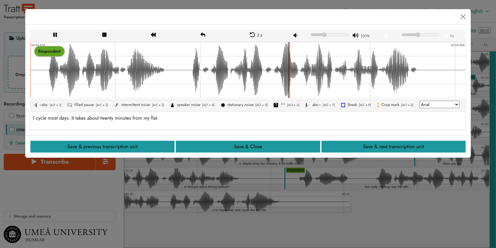
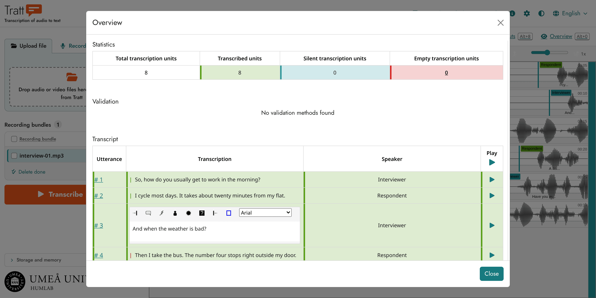
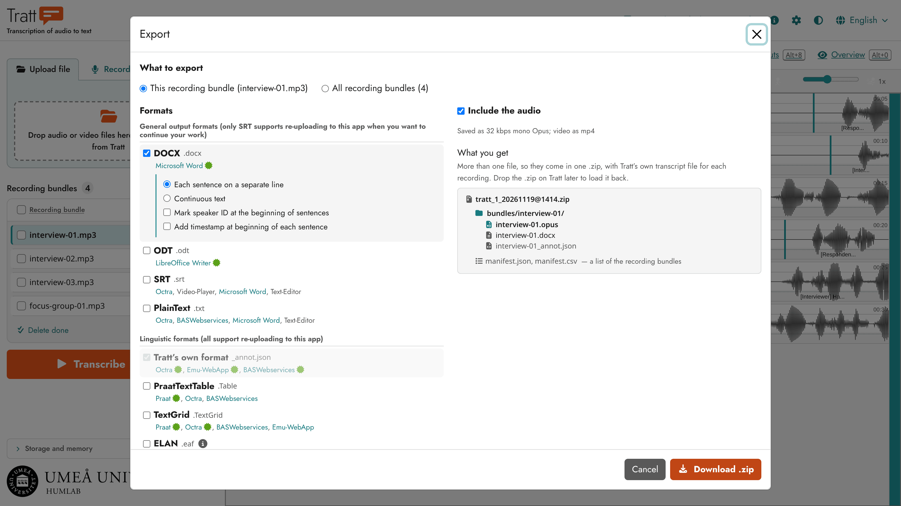

# Quick start: your first transcription

**For:** anyone who has just opened Tratt and has a recording to transcribe.
**You will end up with:** a corrected transcript saved as a file on your computer.
**Time:** about ten minutes of your attention. If you use automatic transcription,
add download and processing time; see step 3.

You do not need an account. You do not need to install anything.

---

## 1. Open Tratt

You land on a page headed **Turn speech into text**.

Use **Chrome**, **Edge**, **Firefox** or **Opera**. Safari works for manual
transcription but cannot run automatic transcription; see
[Troubleshooting](troubleshooting.md#automatic-transcription-is-greyed-out).

## 2. Add your recording

Drop your audio or video file on the dashed box, or click **Choose a file** and
pick it.

Most formats work: `.wav`, `.mp3`, `.m4a`, `.flac`, `.ogg`, `.opus`, `.mp4`,
`.mov`, `.webm` and more. The full list with size limits is in
[Loading a recording](loading-media.md#supported-file-formats).

> **No recording yet?** Switch to the **Record now** tab and record straight into
> the browser. See [Recording in the browser](loading-media.md#recording-in-the-browser).

> **Just looking?** **Try a demo recording**, under the box, loads a sample
> recording so you can see the whole thing work without your own material.

## 3. Decide who writes the first draft

**Tratt transcribes automatically.** Adding a file is the whole instruction: a
speech-recognition model starts on it at once and writes a draft for you to
correct. Two things under the box decide how:

- **Transcription language: …** says which language the model will expect.
  Get this right before you add the file. **Change** opens the settings, where
  you also pick the model size and can turn on **Speaker separation** to have
  Tratt guess who spoke when.
- **Transcribe by hand, without AI** adds the recording *without* running a
  model, for when you would rather type it yourself.

This all runs on your own machine. The only thing fetched from the internet is the
model itself, the first time you use it. Details and model recommendations:
[Automatic draft transcription](automatic-transcription.md).

## 4. Watch it run

The page becomes your workbench: the recording appears in the list headed
**Recording bundles** on the left, and the editor fills the rest of the window.

The row shows how far the work has got, naming each stage in turn: **Preparing**,
**Loading model**, **Transcribing**, **Separating speakers**. On a long recording
this takes a while, and the page has to stay open. When the row says **Done**, the
transcript is in the editor.

Add more recordings whenever you like, by dropping them on the box in the list.
Tratt works through them one at a time. See
[Working with several recordings](workbench.md).

## 5. Correct the text

You arrive in the **2D-Editor**: the recording is drawn as a waveform on several
lines, one line after another, with the text sitting under each chunk of speech.

Tratt calls each of those chunks a **transcription unit**: one utterance, roughly
one line of a subtitle. Other tools call it a segment.

To correct a unit:

1. Move the mouse over it and press **Enter**. A window opens showing just that
   unit's audio and its text.
2. Press **Tab** to play it, **Tab** again to pause, **Esc** to stop.
3. Fix the text.
4. Press **Alt + →** to save and move to the next unit, or **Alt + ↓** to save and
   close the window.

That loop, Enter, Tab, type, Alt + →, is the whole job. Everything else is
refinement.

If you need to mark something that is not a word (a pause, laughter, background
noise, an unintelligible word), use the marker buttons above the text field, or
**Alt + 1** … **Alt + 7**. See [Markers](transcribing.md#markers).

Your progress is saved in the browser continuously. You do not have to press save.

## 6. Look over the whole thing

Press **Alt + 0** to open the **Overview** window. It shows how many units exist,
how many have text, and the whole transcript as a table. Click any row to edit it
there, or click ▶ to hear it.

Each row starts with a coloured bar: orange until you have listened to the unit or
edited its text, then green. Use it to see what is left to check
([details](checking-your-work.md#verified-transcriptions)).

## 7. Export

Click **Export…** under the list of recording bundles. The dialog is headed
*Export*. Tick a format and click **Download**: one recording in one format
downloads as that file, and anything more comes as a `.zip`
([details](exporting.md)).

If you are not sure which one you want:

| You want to… | Choose |
| --- | --- |
| Read or edit the transcript in Word or LibreOffice | **DOCX** or **ODT** |
| Make subtitles | **SRT** or **WebVTT** |
| Keep working in Tratt later, losing nothing | **AnnotJSON** |
| Analyse it in Praat or ELAN | **TextGrid** or **ELAN** |

Word and OpenDocument export can put each utterance on its own line or run it as
continuous text, and can prefix speaker names and timestamps. All the options are
described in [Exporting](exporting.md).

---

## If you have more than one recording

Nothing changes. The same page holds as many recordings as you like: drop them
all on the box, and Tratt works through them one at a time while you edit the one
that is already done. The list is how you move between them, and one export can
take the lot. See [Working with several recordings](workbench.md).

---

## Two things worth knowing before you close the tab

**Tratt remembers your transcript, but never your recording.** When you come back,
the text is still there, but you must drag the same media file in again to keep
working. Export a file whenever you stop for the day.

**Nothing was uploaded.** Your recording stayed on your machine the whole time. See
[How Tratt uses the internet](privacy.md).

---

Next: [How transcribing works](transcribing.md) if you are going to do this often,
or [Keyboard shortcuts](shortcuts.md) if you just want to be faster.
