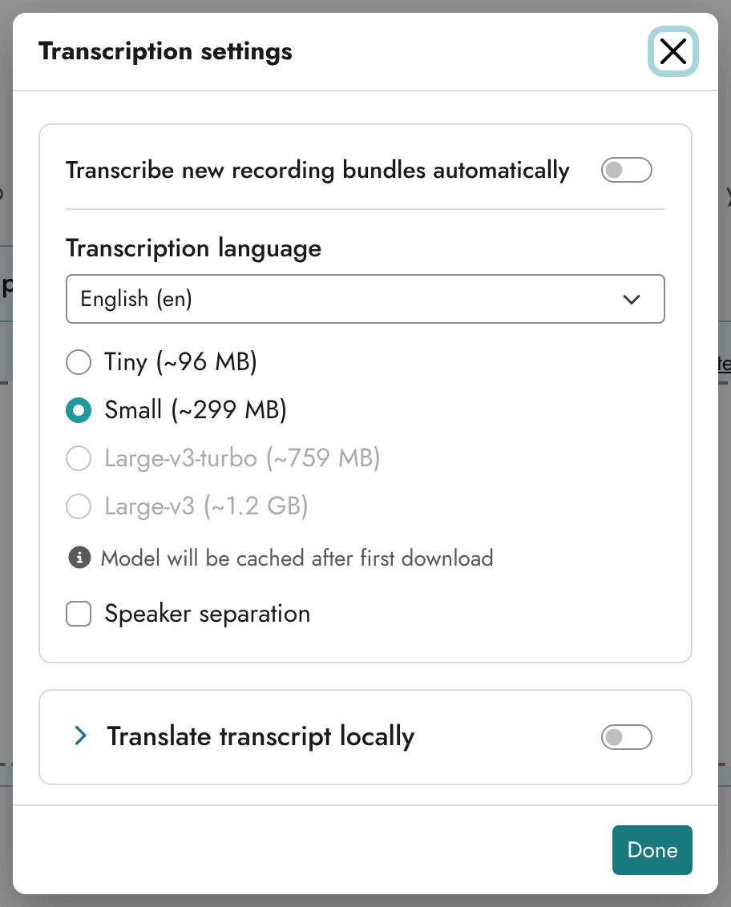

# Automatisk utkasttranskription

**För:** dig som hellre rättar ett utkast än skriver från ingenting.

Tratt kan köra en taligenkänningsmodell **på din egen dator, inne i
webbläsarfliken**, och öppna resultatet i redigeraren så att du kan rätta det.
Den kan också gissa vem som talade när, och översätta det färdiga transkriptet.

Ett utkast är ett utkast. Räkna med att rätta namn, siffror, överlappande tal och
allt som sagts tyst eller vid sidan av mikrofonen. Du sparar skrivandet, inte
lyssnandet.

---

## Slå på det

**Det är redan på.** Att lägga till en inspelning är instruktionen: Tratt ställer
den i kö och en taligenkänningsmodell skriver ett utkast. Du behöver den här
sidan först när du vill ändra vad modellen får veta, eller stoppa den helt.

Kontrollerna ligger i en dialog, **Transkriptionsinställningar**. Öppna den med
**Ändra**, bredvid *Transkriptionsspråk* på den tomma startsidan, eller med
reglageknappen bredvid **Transkribera** när inspelningar ligger i listan.

1. **Transkribera nya inspelningspaket automatiskt**: strömbrytaren överst. Slår
   du av den ligger inspelningar orörda i listan tills du trycker
   **Transkribera**.
2. **Transkriptionsspråk**: det språk som faktiskt talas på inspelningen. Ett
   hundratal språk erbjuds, listade med sina egna namn (*Svenska (Swedish, sv)*,
   *Suomi (Finnish, fi)*), med svenska först och resten i bokstavsordning. Tratt
   förvaljer det språk gränssnittet är inställt på, så byt om inspelningen är på
   något annat. Detta är inte en översättningsinställning.
3. **Modell**: se tabellerna nedan. Listan ändras med språket.
4. **Speaker separation** (talarseparation, valfritt): se
   [Talarseparation](#speaker-separation).
5. **Översätt transkriptionen lokalt**: ett andra avsnitt, hopfällt tills du
   öppnar det. Se [Översätta transkriptionen](#translating-the-transcript).

**Klar** stänger dialogen och behåller det du valt, för den här inspelningen och
nästa.

Vill du lägga till en inspelning *utan* att köra någon modell, använd
**Transkribera för hand, utan AI** under släppytan på startsidan.

Medan en inspelning körs namnger dess rad i listan steget den nått:
**Förbereder**, **Laddar modell**, **Transkriberar**, **Separerar talare**,
**Översätter**. Knappen på raden stoppar just den inspelningen.

### Håll fliken öppen

Arbetet sker i den här fliken. Stäng den inte, och var försiktig med att låta
datorn somna vid långa inspelningar. Att byta till en annan flik går bra;
transkriptionen fortsätter, även om vissa webbläsare bromsar bakgrundsflikar.

---

## Vilken modell ska man välja

Modellistan ändras med språket du valt, eftersom Tratt levererar specialiserade
modeller för de nordiska språken.

**Om din dator har WebGPU** (aktuell Chrome, Edge eller Firefox med ett hyggligt
grafikkort) är alla modeller tillgängliga och de större är mycket snabbare.
**Utan WebGPU** körs modellerna på processorn i stället: de som kräver det
gråmarkeras i listan och går inte att välja, och resten är långsamma men
användbara.

### Svenska

Använder **KB-Whisper** från Kungliga biblioteket, tränad på svenskt tal. Märkbart
bättre än den allmänna modellen för svenska.

| Modell | Ungefär | Anmärkning |
| --- | --- | --- |
| Tiny | 120 MB | Snabbast, minst noggrann. Bra för att kontrollera att kedjan fungerar. |
| Small | 400 MB | Rimlig kompromiss |

> **De två siffrorna gäller processorbygget.** Tiny och Small är de enda
> modeller Tratt hämtar i två kvantiseringar: ett mindre 4-bitarsbygge på en
> dator med WebGPU och ett större 8-bitarsbygge utan. Gränssnittet visar den
> större siffran i båda fallen, så med WebGPU är nedladdningen märkbart mindre
> än det står. Alla andra modeller på den här sidan är samma 4-bitarsbygge på
> båda vägarna, och deras siffror stämmer exakt.
| Medium | 1000 MB | Noggrannare igen. Kräver WebGPU. |
| Large | 1200 MB | Mest noggrann, ungefär halva hastigheten mot Medium. Kräver WebGPU. |

> Modellnamnen i det svenska gränssnittet är delvis felöversatta: flera visas som
> "Liten" oavsett storlek. Gå efter storleken i MB, som stämmer.

### Finska och norska

Också finjusterade modeller. Finska erbjuder Tiny (ca 108 MB), Medium (ca
684 MB) och Large (ca 1210 MB); norska har egna modeller, bland dem en
ordagrann som skriver det som faktiskt sades i stället för att städa upp det.
Allt över Tiny kräver WebGPU.

### Samiska

Nord-, lule- och sydsamiska har egna finjusterade modeller. De finns bara som
Large (ca 1210 MB) och kräver därför WebGPU; på en dator utan det går språket
att välja men ingen modell.

### Alla andra språk

Använder OpenAI:s Whisper.

| Modell | Ungefär | Anmärkning |
| --- | --- | --- |
| Tiny | 95 MB | Snabbast, minst noggrann |
| Small | 290 MB | **Förvald.** En rimlig kompromiss. |
| Large-v3-turbo | 700 MB | Snabb och noggrann. Kräver WebGPU. |
| Large-v3 | 1200 MB | Långsammare än Turbo, ofta något noggrannare. Kräver WebGPU. |

Tratt förväljer Small. Har din dator WebGPU och inspelningen är viktig, byt till
**Large-v3-turbo**.

### Om nedladdningen

Modellen hämtas från `huggingface.co` första gången du använder den och sparas
sedan i webbläsaren, så nästa körning startar direkt. Ditt ljud skickas aldrig
någonstans. Se [Vad lämnar din dator](privacy.md).

Avbryts nedladdningen, försök igen; fortsätter den att misslyckas blockerar
nätverket `huggingface.co` och automatisk transkription är inte tillgänglig på
den datorn.

---

## Talarseparation

Markerar du **Speaker separation** körs ytterligare en modell som delar upp
inspelningen efter talare och märker varje transkriptionsenhet med ett talar-ID.

- Lämna **Expected number of speakers** tomt så gissar den.
- Fyll i om du vet: `2` för en vanlig intervju. Att ange det verkliga antalet ger
  oftast ett renare resultat än automatisk detektering.

Modellen körs på processorn oavsett WebGPU, så den lägger till tid. Räkna med
märkbart längre bearbetning för en lång inspelning.

Resultatet är en utgångspunkt, inte ett fynd. Talare som låter lika, prat i mun på
varandra och bakgrundsröster förvirrar den. Du kan rätta etiketterna efteråt: se
[Nivåer och talare](tiers-and-speakers.md#fixing-speaker-labels).

---

## Översätta transkriptet

Tratt kan också översätta, lokalt, med Opus-MT-modeller.

**På startsidan.** Så snart det finns ett transkript att arbeta med (antingen ett
du laddat in eller ett som automatisk transkription är på väg att skapa) dyker
rutan **Översätt transkriptionen lokalt** upp. Välj **Från** (ett trettiotal
språk) och **Till**. Listan **Till** erbjuder bara språk som faktiskt går att nå
från din källa, och märker vägar som måste gå via engelska med *(två steg)*. Tratt
talar sedan om vilken väg som används:

- *Direkt opus-mt-modell*: en modell, rakt från ditt språk till målspråket.
- *Pivot via engelska (två steg)*: ingen direktmodell finns, så det går via
  engelska. Två modeller att hämta, långsammare att köra, och kvaliteten blir
  något sämre.
- *Ingen lokal översättningsmodell hittades för detta språkpar*: det paret är
  inte möjligt.

Översättningen körs på din dator och kan ta flera minuter. Står den stilla säger
Tratt det i stället för att lämna dig i ovisshet: *Modellinläsningen har fastnat*,
*Översättningen har fastnat, inga framsteg på 60 sekunder*, eller *Nedladdningen
har fastnat, troligen en lagringsgräns i webbläsaren*, som är den att försöka igen
med **Hoppa över webbläsarcache** markerat.

**Under arbetet.** I redigeraren erbjuder nivåmenyn **Add translated tier…**, som
skapar en länkad nivå vars gränser hålls i takt med källnivån, och
**Translate linked tier**, som fyller i de tomma segmenten. Översättningar du har
redigerat för hand skrivs aldrig över. Se
[Nivåer och talare](tiers-and-speakers.md).

**Hoppa över webbläsarcache.** En kryssruta i alternativen. Vissa webbläsare slår
i lagringskvoten när stora modeller ska cachas och fryser. Markeringen förbigår
cachen: modellen laddas ned varje gång, men frysningen försvinner. Använd den bara
om du drabbas av problemet.

---

## När det inte är tillgängligt

**Safari och andra WebKit-webbläsare.** Kryssrutan är inaktiverad med en varning.
Modellerna är stora nog att få Safari att ladda om fliken mitt i nedladdningen,
vilket förstör ditt arbete. Använd Chrome, Edge eller Firefox för automatisk
transkription. Manuell transkribering i Safari påverkas inte.

**Ingen WebGPU.** De modeller som kräver det gråmarkeras med texten
*Kräver WebGPU…*; vilka det är beror på språket. De mindre modellerna fungerar
fortfarande.

**Fel.** Misslyckas transkriptionen medan den körs på WebGPU föreslår
felmeddelandet att du försöker igen utan. Tratt upptäcker WebGPU automatiskt och
har ingen egen omkopplare, så vägen till den långsammare men mer toleranta
processorvägen går genom webbläsaren (Chrome och Edge: `chrome://flags` →
*WebGPU* → **Disabled**, starta om) och en omladdning av Tratt. Alla modeller körs
då på WASM, och de största blir otillgängliga. Mer under
[Felsökning](troubleshooting.md).
