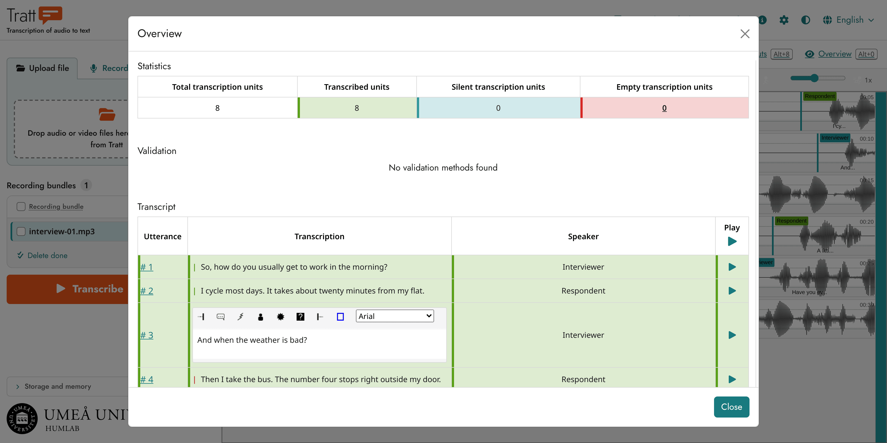

# Kontrollera ditt arbete

**För:** dig som transkriberar och ser att filen är "i princip klar".

---

## Översiktsfönstret

Tryck **Alt + 0**, eller klicka **Översikt** i verktygsraden under sidhuvudet.

Det har tre delar.

### Statistik

| Kolumn | Betyder |
| --- | --- |
| **Totalt transkriptionsenheter** | Hur många enheter den aktuella nivån har |
| **Transkriberade enheter** | Enheter med text i sig |
| **Tysta transkriptionsenheter** | Enheter markerade som paus (`
`) |
| **Tomma transkriptionsenheter** | Enheter med varken text eller paus, ditt återstående arbete |

Sikta på **Tomma transkriptionsenheter = 0** innan du exporterar. Är siffran inte
noll, klicka på den. Tratt markerar då vad som saknas.

### Validering

Namnger projektets riktlinjefil ett valideringsskript listar det här avsnittet
varje nivå med sitt antal fel (normalt *Inga fel hittade*), och den felande
texten stryks under i redigeraren. Är ingen validering konfigurerad står det
i stället *Inga valideringsmetoder hittades*. ⓘ bredvid rubriken förklarar
detta i appen. Båda är normalt; standardriktlinjerna i
Tratt innehåller bara stavnings- och skiljeteckensregler, så i praktiken säger det
här avsnittet sällan något. Tratt erbjuder just nu inte någon möjlighet att ange en egen riktlinjefil.

### Transkript

Varje enhet får i denna vy en tabellrad, som innehåller nummer, start- och sluttid, text, talare (när transkriptet har talare)
och en knapp **Play segment**. ▶ i kolumnrubriken är **Toggle play all**, som
spelar enheterna i följd.

Tabellen går att redigera. Dubbelklicka på en rad så öppnas textfältet på plats,
komplett med markörraden. För en sista genomläsning är det ofta snabbare än att
stega genom vågformen, eftersom du kan läsa sammanhängande och bara stanna där
något ser fel ut. Klicka ▶ på den misstänkta raden, rätta, gå vidare.

**Justera gränser.** Kolumnerna **Start** och **Slut** visar varje enhets tider.
Klicka ◀ för att flytta en tid 10 ms tidigare eller ▶ för att flytta den 10 ms senare (håll **Skift** för 100 ms). Starten
på en enhet är slutet på den föregående, så båda cellerna flyttas tillsammans.
Vila pekaren på en tid en stund så öppnas ett vågformsutsnitt kring gränsen.
Dra den röda linjen för att placera den, eller tryck **Esc** under dragning för
att avbryta. Första starten och sista slutet är låsta, och gränser kan inte
flyttas på en nivå som är länkad till en annan.

**Slå ihop i Översikten.** Varje rad har en kryssruta i kolumnen **Yttrande**,
före numret. Bocka i den för att markera enheten som kandidat för sammanslagning.
De markerade raderna bildar alltid ett block av grannar:

- att bocka i raden direkt ovanför eller under blocket utvidgar det;
- att bocka ur blockets första eller sista rad tar bort den ur blocket;
- **Skift**-klick fyller i luckan upp till den klickade raden;
- att bocka i någon annan rad startar ett nytt block.

Markerade rader mörkas. Ovanför tabellen finns knappen **Slå ihop enheter**.
Den är gråad tills två eller fler rader är markerade, och vilar du pekaren på
den förklarar den varför; sedan står det **Slå ihop N enheter**, med
**Rensa markering** bredvid. Se [Slå ihop enheter](transcribing.md#merging-units) för
vad den sammanslagna enheten innehåller. Kryssrutorna visas inte på en nivå som
är länkad till en annan.

Enhetsnumren fylls ut med nollor till bredden på det största numret (`001`…`842`
för 842 enheter), så att kolumnen håller sig rak.

### Verifierade transkriptioner

Automatiska transkriptioner betraktas från början som **overifierade**. Varje mening inleds av ett färgat
streck, som är **orange** tills en människa kontrollerat den,
**grönt** när den är verifierad. En transkription blir verifierad när du

- lyssnar på dess del av inspelningen (uppspelning av segmentet, i vilken
  redigerare som helst, eller via **Toggle play all** i Översikten. Ett enhet räknas som lyssnad på
  efter 200 ms faktisk uppspelning inom enheten. Det sista sättet att markera enheten som lyssnad på är att
- redigerar texten själv.

Manuellt skriven transkription räknas som verifierad från början. Samma gröna
och orangea streck inleder varje mening i det exporterade
[Word-dokument](exporting.md).

Tratt följer tre regler som man bör vara införstådd med:

- **Lyssning markerar bara den nivå du tittar på.** Spelar du upp inspelningen med
  källnivån vald verifieras inte enheterna i en översättningsnivå. Du måste byta nivå och
  lyssna igen för att verifiera dessa.
- **Hovringsförhandsvisningar räknas inte som uppspelning.** När pekaren förs över vågformen spelas
  korta bläddringsbitar. Denna uppspelning räknas inte, utan enbart riktig uppspelning (Tabb, ▶, **Toggle play all**)
  markerar en enhet som verifierad.
- **Ett transkript som importeras utan `⍻`-märken kommer in helt verifierat.** En
  SRT- eller ELAN-fil från ett annat verktyg saknar märkena, så varje enhet är
  grön från första stund trots att ingen här kontrollerat den. Se
  [verifieringsmarkörer](exporting.md#verification-marks).

---

## Riktlinjer

**Alt + 9**, eller **Riktlinjer** i verktygsraden, öppnar
transkriptionskonventionerna för projektet: stavnings- och skiljeteckensregler,
och betydelsen av varje markör med exempel.

Tratts standardriktlinjer är medvetet tunna (korrekt stavning, inga
skiljetecken) eftersom de är tänkta att ersättas. Har ditt projekt egna
konventioner hör de hemma i riktlinjefilen, så att de är ett tangenttryck bort för
alla som arbetar med materialet, i stället för i ett dokument som ingen öppnar. Tratt har just nu inte 
implementerat möjligheter att byta riktlinjer.

---

## En checklista för sista genomgången

1. **Alt + 0** → *Tomma transkriptionsenheter* är 0.
2. Skumma transkripttabellen uppifrån och ned. Siffror, namn och platser är där
   automatisk transkription är svagast. Kontrollera dem särskilt mot ljudet.
3. Använde du talarseparation, kontrollera talarkolumnen där samtalets tempo
   ändras. Det är där modellen brukar byta för sent eller för tidigt.
4. Kontrollera att oklara partier är markerade (`**`) i stället för gissade.
5. [Exportera](exporting.md), och exportera **AnnotJSON** vid sidan av ditt
   arbetsformat, så att en senare rättelse inte betyder att börja om.
