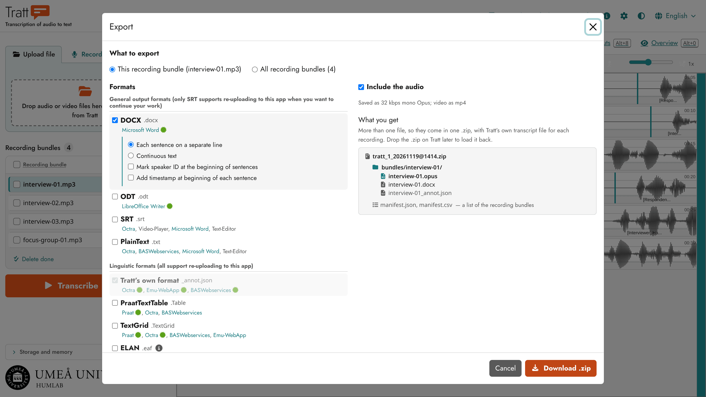

# Exportera

**För:** alla, i slutet av varje arbetspass.

Tratt behåller ditt arbete i webbläsaren. **Din transkription lämnar webbläsaren enbart när du exporterar den till din dator.** 
Se till att exportera ditt arbete varje gång du avslutar ett redigeringspass.

I [Arbetsbänken](workbench.md) klickar du på **Exportera…** under listan med
inspelningspaket:

1. **Vad som ska exporteras**: *Det här inspelningspaketet* (en inspelning som just nu visas i
   redigeraren), *De markerade inspelningspaketen* eller *Alla inspelningspaket*.
   Tratt utgår ifrån att du kan vilja exportera markerade inspelningarna om sådana finns. Om bara en inspelning är laddad så visas inte det här valet.
2. **Format**: markera ett eller flera. Ett markerat format visar sina
   [alternativ](#alternativ) under sig.
3. **Ta med ljudet**: lägger varje inspelnings ljud bredvid dess transkriptioner.
   Det erbjuds bara när något ljud är bifogat. I Arbetsbänkens exportdialog
   från listan är det markerat från början, och ljudet sparas som mono-Opus med
   32 kbit/s (`.opus`). Video exporteras som `.mp4` . Exportknappen i sidhuvudet exporterar
   inget ljud alls, bara transkriptionen.
4. **Det här får du** visar resultatet fil för fil innan du laddar ned det.
5. **Ladda ned**.

**En fil eller en .zip.** Från Arbetsbänkens lista till höger exporteras alltid en
`.zip`-fil. Denna innehåller då allt du behöver för att fortsätta arbetet på de valda filerna vid ett annat tillfälle.
Exportknappen i sidhuvudet ger dig bara en fil, till exempel transkriptionen som DOCX för den inspelning som just nu är öppnad i editorn.
Se 
[Att exportera ett arkiv](#exporting-an-archive) för ytterligare detaljer.


Tratt minns de format du markerade till nästa export.



---

## Vilket format ska jag exportera till?

Dialogen delar in formaten i tre avsnitt och talar om för varje grupp om filen kan
läsas tillbaka in i Tratt.

### Allmänna utdataformat

För att läsa, dela och publicera. **Bara SRT kan läsas tillbaka in i Tratt.**

| Format | Fil | Bra för |
| --- | --- | --- |
| **DOCX** | `.docx` | Det format som öppnas i MS Word och flera andra program. |
| **ODT** | `.odt` | LibreOffice / OpenOffice. Ett öppet filformat som ger samma möjligheter som DOCX. |
| **SRT** | `.srt` | Undertexter, videospelare, och det enda formatet i gruppen som går att importera igen för att fortsätta ditt arbete senare |
| **PlainText** | `.txt` | Alla program som läser vanlig text |

### Lingvistiska format

Alla dessa kan läsas tillbaka in i Tratt.

| Format | Fil | Bra för |
| --- | --- | --- |
| **Tratts eget format** (AnnotJSON) | `_annot.json` | Emu SDMS-kompatibelt. Behåller allt: nivåer, gränser, talare och markörer. I Arbetsbänkens exportdialog från listan är det alltid med och kan inte avmarkeras. |
| **TextGrid** | `.TextGrid` | Praats primära annoteringsformat |
| **ELAN** | `.eaf` | Formatet som ELAN använder. Lägg `.eaf`-filen i samma mapp som ljudet, annars hittar ELAN inte mediet. |
| **PraatTextTable** | `.Table` | Praats tabellformat |

### Specialiserade tekniska format

| Format | Fil | Bra för |
| --- | --- | --- |
| **WebVTT** | `.vtt` | Undertexter för webbvideo |
| **BASPartitur** | `.par` | BAS-webbtjänsterna. Exporten skriver ORT- och TRN-rader ur transkriptionen. |
| **CTM** | `.ctm` | Verktyg för utvärdering av taligenkänning. Konfidensvärdet skrivs alltid som 1. Tratt håller inte reda på det. |

> **Behåll Tratts eget format.** DOCX och ODT går inte att importera till Tratt igen. 
> Om du vill kunna korrigera transkriptionerna om ett halvår är det Tratts
> egen fil plus originalinspelningen som du måste se till att exportera. I
> Arbetsbänkens exportdialog från listan är dessa alltid med och kan inte
> avmarkeras.

---

## Alternativ

### DOCX och ODT

| Alternativ | Effekt |
| --- | --- |
| **Each sentence on a separate line** / **Continuous text** | En transkriptionsenhet per rad, eller allt sammanskrivet som löpande text |
| **Markera talar-ID i början av meningar** | Sätter talaretiketten först i varje enhet |
| **Add timestamp at beginning of each sentence** | Sätter starttiden först i varje enhet |
| **Collect annotations according to transcription tier in the output** | Visas när en inspelning har fler än en nivå: grupperar utdata nivå för nivå i stället för att blanda |

Varje mening börjar med ett färgat streck i de exporterade Word- (DOCX) och
ODT-filerna. En kort rad i transkriptionens början förklarar färgerna: ett
**grönt** `|` markerar en transkription du verifierat (lyssnat på dess del av
inspelningen, eller redigerat texten). Ett **orange** `|` markerar ett yttrande som
innehåller den automatiska transkriptionen som ej verifierats.

<a id="verification-marks"></a>

### Verifieringsmarkörer i tidsanpassade format

De tidsanpassade exportformaten (SRT, WebVTT, ELAN, TextGrid, PraatTable,
CTM, BAS Partitur, Whisper JSON) visar verifieringsstatusen i själva texten:
varje overifierad transkription slutar med ett **not-check-märke** (`⍻`,
U+237B). Verifierade meningar skrivs utan denna markering. När du senare laddar en sådan
fil tillsammans med dess ljud läser Tratt tillbaka märket. 

### PlainText

| Alternativ | Effekt |
| --- | --- |
| **Markera talar-ID i början av meningar** | Som ovan |
| **Lägg till en radbrytning efter varje transkriptionsenhet** | En enhet per rad |
| **Separera transkriptionsenheter med läsbara tidsstämplar (HH:MM:SS.s)** | Läsbara tider mellan enheter |
| **Separera transkriptionsenheter med sampelpunkter** | Sampellägen mellan enheter, för att lägga texten mot signalen någon annanstans |
| **Collect annotations according to transcription tier in the output** | Visas när en inspelning har fler än en nivå |

Markerar du båda tidsalternativen infogas båda.

### SubRip och WebVTT

| Alternativ | Effekt |
| --- | --- |
| **Move units with speaker label to separate levels** | En nivå per talare i stället för en blandad nivå med talar-ID markerad i början av varje yttrande|
| **Combine empty units with max duration (ms) between units of the same speaker** *(SRT)* | Slår ihop en kort lucka mellan två turer av samma person. |

### Nivåer

Alla nivåer exporteras; det finns inget att välja. Detta spelar bara roll när ett
transkript har mer än en nivå, till exempel en översättning.

- **Tratts eget format, TextGrid, PraatTextTable, ELAN** bär flera nivåer i samma fil.
- **DOCX, ODT och PlainText** lägger alla nivåer i en fil. Hur du väljer i alternativet *Collect
  annotations according to transcription tier* avgör om de grupperas nivå för
  nivå eller blandas.
- **SubRip, WebVTT, BASPartitur, CTM** rymmer bara en nivå och Tratt skriver därför en fil
  per nivå, namngiven efter den: `intervju-Transcript.srt` och
  `intervju-Swedish (sv).srt`. Med mer än en fil kommer exporten som en `.zip`.

### Metadata

När du exporterar inspelningspaketet som är öppet i redigeraren erbjuder dialogen
också, under *Mer för den här transkriptionen*, de metadata som loggats medan du
arbetade (**Protocol**). De finns bara om **Logga användaråtgärder** var på i
Inställningar. Det är ett
forskningsmaterial (tangent- och uppspelningshistorik), inte en del av
transkriptet. Precis som övrig information i Tratt skickas inte denna information till någon extern tjänst utan kan bara laddas ner av användaren själv.

---

<a id="exporting-an-archive"></a>

## Arkivet, och hur du tar vid där du slutade

Vid export av en session packar Tratt alla inspelningar och deras transkriptioner i en `.zip`. 
Denna fil  är tänkt som sättet att
flytta arbete mellan datorer, lämna över till en kollega, eller helt enkelt
lägga undan en session och återuppta den nästa vecka.

### Vad som ligger i det

Namnet säger vad det innehåller och när det skrevs:
`tratt_12_20261008@1923.zip` är tolv inspelningspaket, skrivna den 8 oktober
2026 klockan 19:23 lokal tid.

```
tratt_2_20261119@1754.zip
├── bundles/
│   ├── interview-01/
│   │   ├── interview-01.opus         ljudet, om du markerade Inkludera ljudet
│   │   ├── interview-01_annot.json   Tratts eget format: transkriptionen
│   │   └── interview-01.docx         varje format du markerade
│   └── interview-02/
│       └── …
├── manifest.json
└── manifest.csv
```

Varje inspelning får en egen mapp under `bundles/`, och det är det som hindrar
två inspelningar med samma namn (`take.wav` och `take.wma`) från att skriva över
varandras transkriptioner.

De två **manifesten**-filer i roten listar varje inspelningspaket med sökvägar och
uppgifter: källfilens namn, längd i sampel, samplingsfrekvens, modell och språk
som användes, vilka steg som kördes, antalet transkriptionsenheter och vilken
version av Tratt som skrev det. `manifest.csv` öppnas i ett kalkylprogram,
vilket gör den användbar som register över en korpus.

När ljudet konverteras räknar Tratts eget format och manifesten sampel vid
16 kHz, takten Tratt läser tillbaka ljudet i, medan själva `.opus`-filen är
48 kHz. Konverteringen gör att tiderna kommer att stämma överens trots att din inspelning komprimerats.

<a id="loading-an-archive-back"></a>

### Att läsa in exportarkivet igen

**Släpp `.zip`-filen på dra-och-släpp-ytan.**  Tratt packar då upp
den och lägger tillbaka varje inspelning i listan med

- sitt **ljud redan bifogat**, så att du kan spela upp och lägga om gränser
  direkt, ingenting att bifoga på nytt;
- sin **transkription** så som den var vid exporten, med nivåer, talare, markörer och
  verifieringsstatus.

Två saker att notera:

- **Automatisk transkribering och översättning slås av** när arkivet läses in,
  och en pågående kö stoppas. Detta görs så att dina transkriptioner inte av misstag ska skrivas över.
   Slå på dem igen i
  [Transkriptionsinställningar](automatic-transcription.md#turning-it-on) om du
  vill göra ett nytt försök att automatiskt transkribera materialet.
- **En inspelning heter som filen i arkivet.** Eftersom ljudet konverterades på
  vägen ut kommer `interview-01.mp3` tillbaka som `interview-01.opus`.


Tratt bortser från DOCX, ODT och andra textdokument vid inläsning. Detta betyder att 
 ett arkiv där du har lagt till egna filer eller råkat redigera DOCX-filer i
går ändå att läsa in.

Ett inspelningspaket vars ljud inte var bifogat när du exporterade har inget
ljud i arkivet, bara sin transkription. Att släppa arkivet läser in den
transkriptionen i inspelningspaketet med samma namn som redan ligger i listan. Du måste då sedan själv ladda in ljudfilen.
 Exportdialogen säger hur många inspelningar som riskerar att inte vara kompletta vid export eftersom ljudet saknas, och rapporterar *Klar med varningar* i stället för att låta hela
exporten misslyckas.

---

<a id="formats-tratt-can-read"></a>

## Format Tratt kan läsa

Släpp dessa tillsammans med ditt ljud på startsidan för att fortsätta ett
befintligt arbete.

| Format | Anmärkning |
| --- | --- |
| **Tratt-arkiv** (`.zip`) | En hel session, ljud och transkriptioner tillsammans. Se [Att exportera ett arkiv](#exporting-an-archive). |
| **AnnotJSON** (`_annot.json`) | Fullständig beskrivning av transkriptet för en inspelning. |
| **WhisperJSON** (`.json`) | Utdata från Whisper / WhisperX kört någon annanstans. Bara tidsstämplar och text läses; allt annat ignoreras. |
| **SubRip** (`.srt`) | Med alternativ för talarextraktion, se [Nivåer och talare](tiers-and-speakers.md#importing-material-that-already-has-speakers) |
| **WebVTT** (`.vtt`) | Läser `<v Namn>`-taggar. STYLE-, REGION- och NOTE-block ignoreras; flerradiga textblock slås ihop. |
| **PlainText** (`.txt`) | |
| **TextGrid** (`.TextGrid`), **PraatTextTable** (`.Table`) | |
| **ELAN** (`.eaf`) | Bara nivåattributet `ANNOTATION` tolkas |
| **BASPartitur** (`.par`) | TRN- och ORT-rader slås ihop till en nivå av tidsanpassade enheter |
| **CTM** (`.ctm`) | |

Transkriptfilens namn måste matcha ljudfilens namn, annars avvisar Tratt den med
*Transkriptfilens namn matchar inte ljudfilens namn*.

DOCX- och ODT-filer kan inte importeras till Tratt.

---

## Egna tabeller

Har inget av ovanstående de kolumner du behöver, bygg din egen med
**Table-Configurator**, under *Mer för den här transkriptionen* längst ned i
exportdialogen när du exporterar inspelningspaketet som är öppet i redigeraren. Se
[Verktyg → Tabellkonfiguratorn](using-tools.md#table-configurator).
