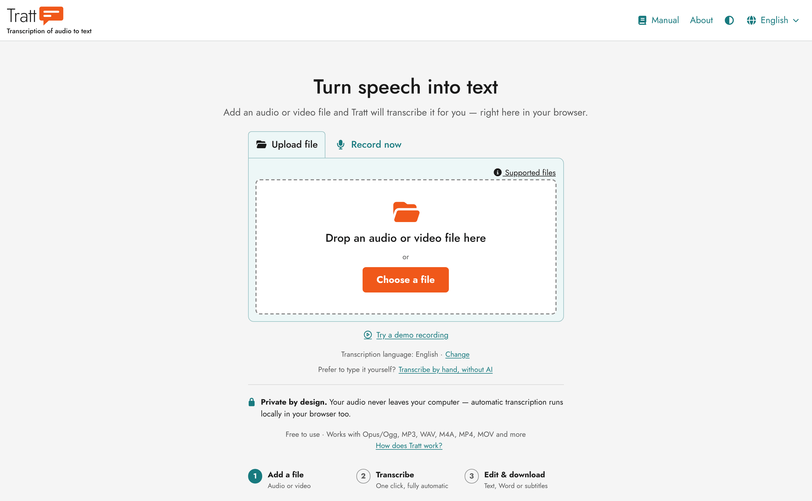
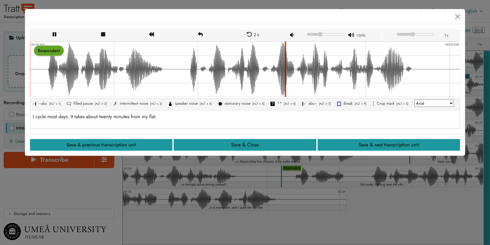
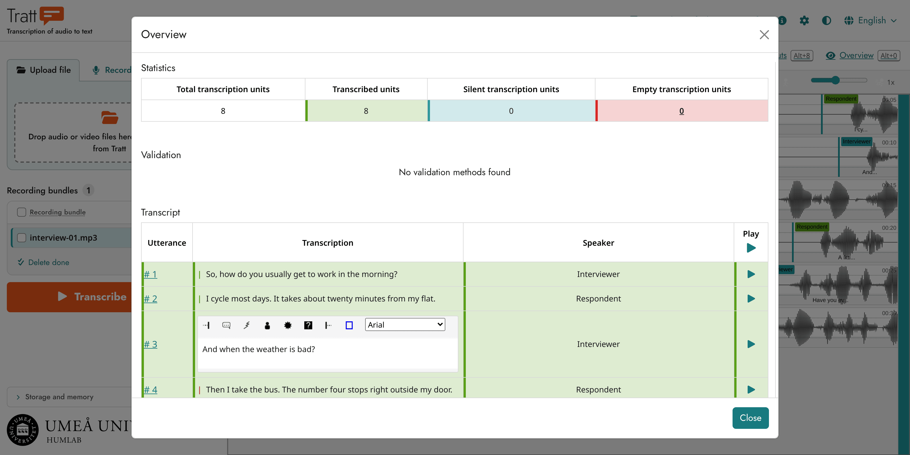
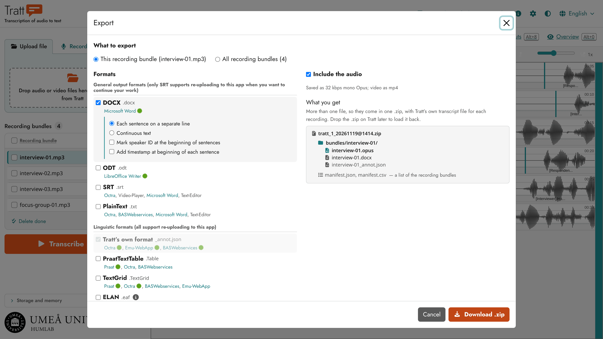

# Snabbstart: din första transkription

**För:** dig som just har öppnat Tratt och har en inspelning att transkribera.
**Du får:** dina korrigerade transkriptioner sparade tillsammans som en fil på din dator.
**Tid:** ungefär tio minuters genomläsning. Använder du automatisk transkription
tillkommer tid för nedladdning och bearbetning, se steg 3.

---

## 1. Öppna Tratt

Du landar på en sida med rubriken **Gör tal till text**.

Använd **Chrome**, **Edge**, **Firefox** eller **Opera**. Safari fungerar för
manuell transkribering men kan inte köra automatisk transkription. Se
[Felsökning](troubleshooting.md#automatic-transcription-is-greyed-out).

## 2. Lägg till din inspelning

Släpp din ljud- eller videofil på den streckade rutan, eller klicka på **Välj en
fil** och leta upp den.

De flesta format fungerar: `.ogg`, `.opus`, `.wav`, `.mp3`, `.m4a`, `.flac`,
`.mp4`, `.mov`, `.webm` med flera. Hela listan med storleksgränser finns under
[Ladda in en inspelning](loading-media.md#supported-file-formats).

> **Har du ingen inspelning än?** Byt till fliken **Spela in nu** och spela in
> direkt i webbläsaren. Se
> [Spela in i webbläsaren](loading-media.md#recording-in-the-browser).

> **Bara nyfiken?** **Prova med en exempelinspelning**, under rutan, laddar en
> exempelinspelning så att du kan se hela kedjan fungera utan eget material.

## 3. Bestäm vem som skriver utkastet

**Tratt transkriberar automatiskt.** Att lägga till en fil startar processen. En
taligenkänningsmodell sätter i gång direkt och skriver ett utkast som du sedan
rättar. Två saker i inställningsrutan styr:

- **Transkriptionsspråk: …** anger vilket språk modellen ska förvänta sig.
  **Ändra** öppnar inställningarna, där du också väljer modellstorlek och kan
  slå på **talarseparation** så att Tratt gissar vilken talare som talar när.
- **Transkribera för hand, utan AI** lägger till inspelningen *utan* att köra
  någon modell, för dig som hellre skriver själv.

Allt detta körs på din egen dator. Det enda som hämtas från internet är själva
modellen, första gången du använder den. Detaljer och rekommendationer:
[Automatiskt transkriptionsutkast](automatic-transcription.md).

## 4. Se den arbeta

Inspelningen dyker upp i listan **Inspelningspaket**
till vänster, och redigeraren fyller resten av fönstret.

Raden visar hur långt arbetet har kommit och namnger varje steg i tur och
ordning: **Förbereder**, **Laddar modell**, **Transkriberar**, **Separerar
talare**. För en lång inspelning tar det en stund, och sidan måste vara kvar
öppen. När raden säger **Klar** ligger transkriptionen i redigeraren.

Lägg till fler inspelningar när du vill genom att släppa dem på rutan i listan.
Tratt arbetar igenom dem en i taget. Se
[Arbeta med flera inspelningar](workbench.md).

## 5. Rätta texten

Du hamnar i **2D Vy**: inspelningen ritas som en vågform på flera rader, en rad
efter den andra, med texten under varje talstycke.

Tratt kallar varje sådant stycke en **transkriptionsenhet**, och de motsvarar
ungefär ett yttrande.

Så här rättar du en enhet:

1. För muspekaren över den och tryck **Enter**. Ett fönster öppnas med just den
   enhetens ljud och text.
2. Tryck **Tabb** för att spela upp, **Tabb** igen för att pausa, **Esc** för att
   stoppa.
3. Rätta texten.
4. Tryck **Alt + →** för att spara och gå till nästa enhet, eller **Alt + ↓**
   för att spara och stänga fönstret.

Den slingan (Enter, Tabb, skriv, Alt + →) är det grundläggande arbetssätt du
kommer att använda i de flesta fall.

Behöver du markera något som inte är ord (en paus, skratt, bakgrundsljud, ett
oförståeligt ord) använder du markörknapparna ovanför textfältet, eller
**Alt + 1** … **Alt + 7**. Se [Markörer](transcribing.md#markers).

Ditt arbete sparas fortlöpande i webbläsaren.

## 6. Se över helheten

Tryck **Alt + 0** för att öppna **Översikt**. Den visar hur många enheter som
finns, hur många som har text, och hela transkriptet som en tabell. Klicka på en
rad för att redigera den där, eller på ▶ för att lyssna på den.

Varje rad börjar med ett färgat streck: orange tills du lyssnat på enheten eller
redigerat dess text, sedan grönt. Använd det för att se vad som återstår att
kontrollera ([mer](checking-your-work.md#verified-transcriptions)).

## 7. Exportera

Klicka på **Exportera…** under listan med inspelningspaket. Dialogen heter
*Exportera*. Markera ett format och klicka på **Ladda ned**: en inspelning i ett
format laddas ned som den filen, och allt mer kommer som en `.zip`
([detaljer](exporting.md)).

Om du är osäker på vilket du vill ha:

| Du vill… | Välj |
| --- | --- |
| Läsa eller redigera transkriptet i Word eller LibreOffice | **DOCX** eller **ODT** |
| Göra undertexter | **SRT** eller **WebVTT** |
| Kunna arbeta vidare i Tratt senare utan att förlora något | **AnnotJSON** |
| Analysera i Praat eller ELAN | **TextGrid** eller **ELAN** |

Export till Word och OpenDocument kan lägga varje yttrande på egen rad eller köra
det som löpande text, och kan sätta talarnamn och tidsstämplar först. Alla
alternativ beskrivs under [Exportera](exporting.md).

---

## Om du har fler än en inspelning

Arbetssättet är i stort sett detsamma. Släpp inspelningarna på rutan, så arbetar
Tratt igenom dem en i taget medan du redigerar den som redan är klar. Listan är hur du flyttar dig mellan dem, och en enda export
kan ta med alltihop. Se [Arbeta med flera inspelningar](workbench.md).

---

## Två saker värda att veta innan du stänger fliken

**Tratt minns ditt transkript, men aldrig din inspelning.** När du kommer
tillbaka finns texten kvar, men du måste dra in samma mediefil igen för att
kunna arbeta vidare. Det bästa arbetssättet är att exportera din uppsättning
inspelningar till en `.zip`-fil efter en session. Den `.zip`-filen innehåller då
också dina inspelningar, och du kan läsa in den igen när du vill fortsätta.

**Ingenting laddas upp någonstans.** Din inspelning stannade på din dator hela
tiden. Se
[Hur Tratt använder internet](privacy.md).

---

Läs vidare: [Så fungerar transkribering](transcribing.md) om du ska göra det här
ofta, eller [Tangentbordsgenvägar](shortcuts.md) om du bara vill bli snabbare.
