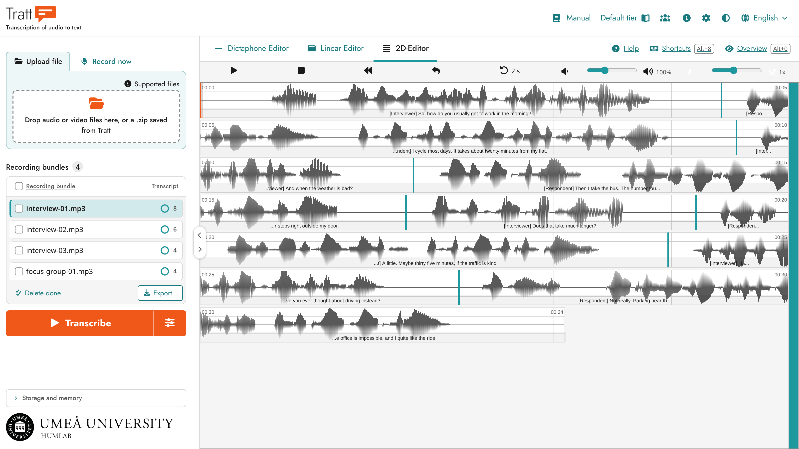

# Arbeta med flera inspelningar

**För:** dig som har en mapp med inspelningar snarare än en enda fil.

Tratt har en enda arbetsyta, och den rymmer hur många inspelningar du vill.

Vyerna, genvägarna, markörerna, nivåerna och exportformaten är de som beskrivs i
resten av manualen.

## En inspelning eller flera

| | En inspelning | Flera |
| --- | --- | --- |
| Automatisk transkription | Startar så fort filen är inne | En kö som arbetar sig genom listan, en i taget |
| Byta mellan inspelningar | — | Klicka på en rad i listan |
| Export | Den inspelningen | En av dem, de markerade, eller alla i ett arkiv |

---

## Inspelningspaket

Varje post i listan är ett **inspelningspaket**: en inspelnings ljud tillsammans
med dess transkription. De två delarna beter sig olika:

- **Transkriptionen** sparas i webbläsaren medan du arbetar och finns kvar när du
  kommer tillbaka.
- **Ljudet** sparas aldrig. Tratt läser det från din dator så länge sidan är
  öppen, så efter en omladdning har ett inspelningspaket sin transkription men
  inget ljud förrän du bifogar ljudet igen.

Listan visar båda delarna: i kolumnen före namnet visar ett inspelningspaket
**Bifoga** när dess ljud inte är bifogat, och kolumnen **Transkription** säger
var transkriptionen står. I den här manualen betyder *fil* bara en fil på din
dator, alltså den du släpper, väljer eller laddar ned.

---

## Så ser den ut

Fyra saker ligger till vänster, uppifrån och ned:

1. **Inspelningspaket** med deras antal, och knapparna **Exportera…**,
   **Radera klara** och **Ta bort**.
2. Flikarna **Ladda upp fil** och **Spela in nu** över en släppyta:
   *Släpp ljud- eller videofiler här, eller en .zip som du sparat från Tratt*.
   Medan ett inspelningspaket väntar på sitt ljud säger släppytan att den ljudfilen
   bifogas till det.
3. **Transkription**: transkriptionsinställningarna, om nya filer transkriberas
   automatiskt, och — när någon fil väntar — knappen som startar kön.
4. **Lagring och minne**: två kapacitetsmätare, **Webbläsarlagring** och
   **Arbetsminne (uppskattat)**, över **Radera all data permanent**.

Resten av fönstret är det inspelningspaket du valt i listan. Listan är det enda
stället där du byter inspelningspaket. Håll pekaren över ett för att se ljudets
uppgifter. Ovanför vyn
finns en rad med vyflikarna, **Genvägar**, **Översikt** och **Hjälp**. Under den
kommer själva vyn.

---

## Att lägga till inspelningar

Släpp så många ljud- eller videofiler du vill på släppytan samtidigt, eller klicka
på den och välj dem. Varje fil blir en egen post i listan med sin egen
transkription. Format och storleksgränser är desamma som överallt annars och
listas under
[Ladda in en inspelning](loading-media.md#supported-file-formats).

**En transkriptfil** hör till sin inspelning: släpp den tillsammans med ljudet,
eller efter att ljudet redan ligger i listan. Tratt parar ihop de två på namn och
säger till när det inte går:

- *Ingen inspelning heter "x". Släpp transkriptionen tillsammans med ljudfilen,
  eller döp den som inspelningen.*
- *Bifoga ljudet för "x" först och släpp sedan transkriptionen igen.*
- Att ersätta en transkription som redan har text kräver en bekräftelse, eftersom
  dina ändringar i den skulle gå förlorade.

**Spela in nu** spelar in direkt i listan, precis som på den tomma startsidan.
Se
[Spela in i webbläsaren](loading-media.md#recording-in-the-browser).

### Att läsa in ett exporterat arkiv

Släpp en `.zip` som Tratt exporterat tidigare på samma drag-och-släppyta. Varje
inspelning i den laddas då in med sitt ljud bifogat och sin transkription på
plats, och automatisk transkribering stoppas så att färdigt arbete inte
transkriberas över. Det är det tänkta sättet att återuppta en session, flytta
arbete mellan datorer eller lämna över till en kollega. En beskrivning av
arbetsgången, med vad arkivet innehåller och vad som ändras på vägen tillbaka in,
finns under
[Arkivet, och hur du tar vid där du slutade](exporting.md#exporting-an-archive).

---

## Transkription

Den stora orange knappen **Transkribera**, under listan med inspelningspaket, är
en delad knapp. Dess vänstra del startar transkriberingen; dess högra del
(reglageikonen) öppnar **Transkriptionsinställningar** som ger dig möjlighet att ställa in modellen,
transkriptionsspråket, talarseparation och lokal översättning, som beskrivs
under [Automatisk utkasttranskription](automatic-transcription.md). Håll pekaren
över reglageikonen för att se de aktuella inställningarna utan att öppna dem.

**Transkribera nya inspelningspaket automatiskt** är en strömbrytare högst upp i
inställningarna. När den är aktiverad transkriberas filer när de kommer in. Du kan
släppa in flera inspelningar och vänta på att alla blir bearbetade. När det inte
finns något kvar att göra står det **Autotranskribering på** på knappen.

När den är av väntar nya inspelningspaket. Knappen säger **Transkribera N** och
kör kön över varje inspelningspaket som ännu inte har någon transkription, och
hoppar över dem vars ljud inte är bifogat. Medan kön körs transkriberas filerna
en i taget och knappen blir körningens förloppsfält: *Transkriberar 2 av 5*, som
fylls på medan filerna blir klara. Medan en fil förbereds (dess ljud läses, och
första gången laddas dess modell) pulserar dess del av fältet. Att klicka på
knappen stoppar körningen efter att du bekräftat: filen som pågår avbryts, och de
filer som fortfarande väntar transkriberas inte.

Knappen går alltid att klicka på. När den inte har något att göra säger den
varför, och dess hjälptext säger det också.

### Att transkribera en fil igen

Vill du transkribera en fil igen, till exempel med en större modell eller andra
inställningar, markerar du den i fillistan. Knappen säger då **Transkribera N
markerade**. Filer som redan har en transkription transkriberas bara om efter att
du bekräftat. Deras nuvarande transkription **ersätts och kan inte återställas**,
inklusive de rättelser du gjort, så använd **Exportera…** först om du vill behålla
en kopia. Bekräftelsen anger hur många avsnitt en person redan har rättat eller
kontrollyssnat.

Redigerar du en fils transkription medan den transkriberas om behålls dina
ändringar och det nya resultatet kastas.

---

## Att följa arbetet

Varje rad i **Inspelningspaket** visar i kolumnen **Transkription** var i processen
transkriptionen befinner sig:

| Status | Betyder |
| --- | --- |
| **I kö** | Väntar på sin tur |
| **Körs** | Arbetas med nu, med aktuellt steg och hur långt det kommit, t.ex. *Transkriberar 40 %* |
| **Klar** | Färdig |
| **Misslyckades** | Stoppade på grund av ett fel. Du kan klicka **Försök igen** på raden |
| **Avbruten** | Stoppad av dig, eller av att sidan stängdes eller laddades om halvvägs. **Försök igen** finns på raden |
| **Har text** / **Ej transkriberad** | Automatisk transkription har aldrig körts. Den transkription som finns är antingen importerad eller skriven för hand |

Stopp-knappen på raden stoppar just det inspelningspaketet (*Sluta transkribera det här
inspelningspaketet*) och lämnar resten av kön i fred.

En misslyckad fil säger vad som gick fel (*Kunde inte läsa ljudet*,
*Kunde inte ladda modellen*, *Minnet tog slut*, *Avbruten*, eller bara
*Misslyckades*).
**Minnet tog slut** betyder att det bifogade ljudet är för stort för det minne som
finns tillgängligt, se [Kapacitet](#capacity) nedan.

---

## Att redigera ett resultat

Klicka på ett inspelningspaket i listan för att öppna det. Håll pekaren över det
för att se ljudets uppgifter, till exempel `1:45 · 16 kHz mono · 3.4 MB`. Är
ljudet inte bifogat står det *Ljud inte bifogat*, och **Bifoga ljud…** sitter
längst till höger i raden med vyflikarna.

Därefter är du i den vanliga redigeringsmiljön. Du väljer 2D Vy, Diktafon-vy eller
Linjär vy med vyflikarna och arbetar som beskrivs under
[Så fungerar transkribering](transcribing.md). **Genvägar** (Alt + 8) och
**Översikt** (Alt + 0) finns i samma rad som flikarna.

Att spela en enhet eller redigera dess text markerar den som
[verifierad](checking-your-work.md#verified-transcriptions).

Ändringar sparas medan du skriver, för varje inspelning. Att byta till en annan fil i
listan gör inte att Tratt förlorar data.

---

## Att komma tillbaka senare

Tratt lagrar inspelningspaketens transkriptioner men aldrig deras ljud. När du
återvänder möts du av en **Välkommen tillbaka**-ruta: *Tratt har kvar dina
transkriptioner från förra gången, men inte ditt ljud. För att lyssna och rätta,
bifoga varje inspelningspakets ljud med ”Bifoga” i listan, eller släpp samma
ljudfiler här.* Välj samma fil från disken (med **Bifoga** i listan, **Bifoga
ljud…** i sidhuvudet, eller genom att släppa den) så fortsätter redigeringen där
du slutade. Till dess säger vyn *Det här inspelningspaketets ljud är inte
bifogat*, med en knapp **Bifoga ljud…**.

Om filen du väljer inte verkar vara den posten skapades från stannar Tratt och
frågar: *Det här ser inte ut som samma ljud*, med vad du valde och vad som
förväntades sida vid sida, och **Använd ändå**. När bara ändringstiden skiljer sig
anger Tratt det, eftersom det brukar vara en kopia eller omexporterat ljud
snarare än fel inspelning.

Du kan också exportera ett arkiv innan du slutar och
[läsa in det igen](#loading-an-archive) nästa gång, vilket återställer ljudet och
transkriptionerna tillsammans och inte kräver någon separat bifogning.

---

## Kapacitet

De två mätarna i denna ruta mäter olika saker, men bara den ena begränsar hur mycket du kan ha
igång.

**Webbläsarlagring** är det Tratt behåller internt i webbläsaren, men på disken. Detta innefattar nedladdade modeller och dina
transkriptioner. Noten under den uppskattar båda, till exempel *modeller ca 210 MB
för nuvarande pipeline + annoteringar ca 221 MB*. **Media skrivs aldrig till
lagringen**, och därför fyller en mapp med stora inspelningar inte upp denna lagring. Vissa
webbläsare rapporterar inte användning alls, och mätaren är då otillgänglig.

**Arbetsminne (uppskattat)** är avkodat ljud som hålls i fliken.
Varje inspelning vars ljud är bifogat tar minne så länge det
är bifogat. Är du nära taket, eller misslyckas en fil med *Minnet tog slut*, föreslås du arbeta
igenom materialet i mindre samlingar. När du är klar med en samling väljer du exportera och sedan 
[Radera klara](#housekeeping), vartefter du bifogar de nästkommande filerna.

Längst ned i panelen tömmer **Radera all data permanent** den här webbläsarens
lagring. Det som raderas är alla transkriptioner, loggar och inställning, inte bara inspelningarna i
listan. Tratt frågar först för ytterligare bekräftelse av åtgärden, och laddar sedan om sig själv, så att du står på den
tomma startsidan. Exportera innan du använder den; se
[Hur Tratt använder internet](privacy.md#rensa-dina-data).

---

## Att få ut resultaten

**Exportera…** under listan öppnar exportdialogen, som beskrivs under
[Exportera](exporting.md). Där väljer du vad som ska exporteras: inspelningspaketet
som är öppet i redigeraren, de du har markerat, eller alla. Du kan göra en export även när
ljudet inte är bifogat. Inspelningspaket utan transkription utelämnas dock.

Vad arkivet innehåller, och hur du läser in det igen, beskrivs under
[Att exportera ett arkiv](exporting.md#exporting-an-archive).

---

## Att hålla ordning

**Radera klara** raderar inspelningspaketen markerade *Klar*, transkriptionerna också. **Ta bort** tar bort
dem du markerat, och kryssrutan i listans rubrikrad markerar alla. **Dessa åtgärder kan inte ångras**.
