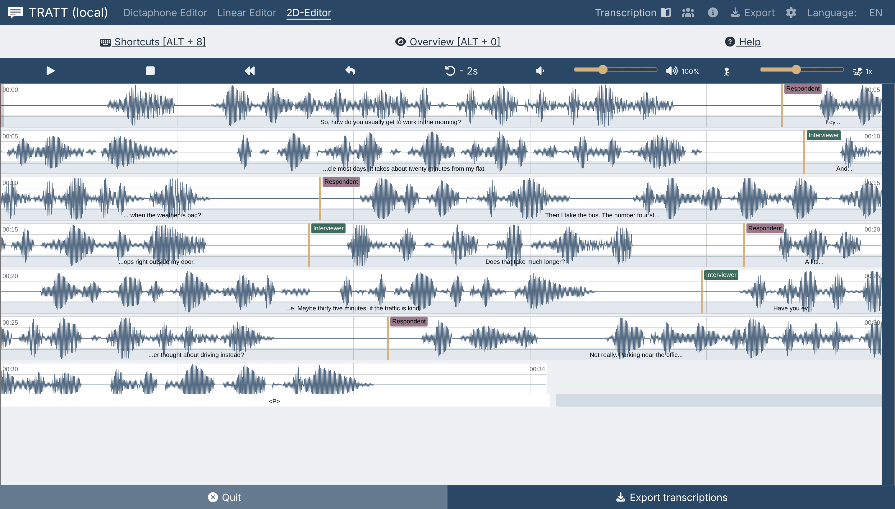
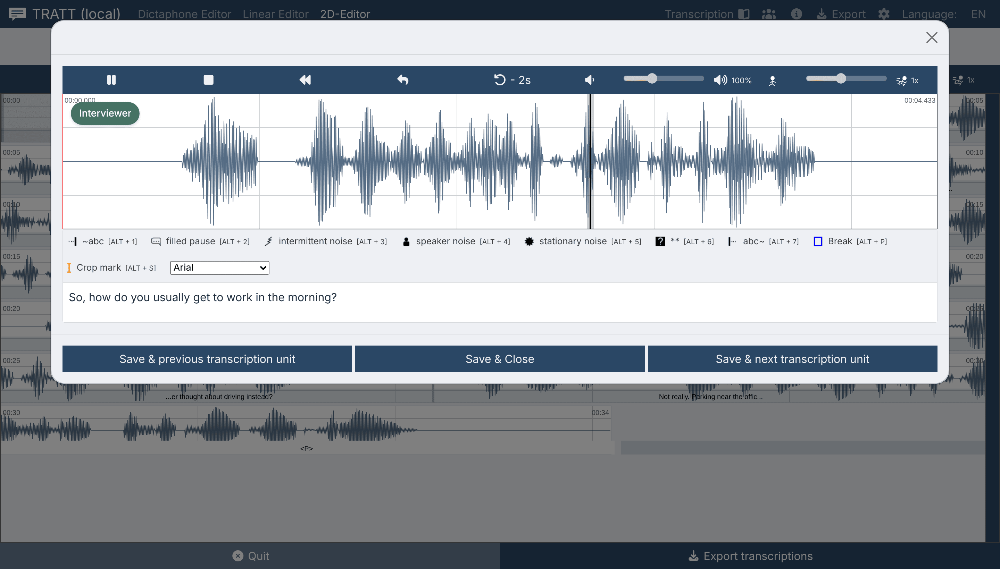
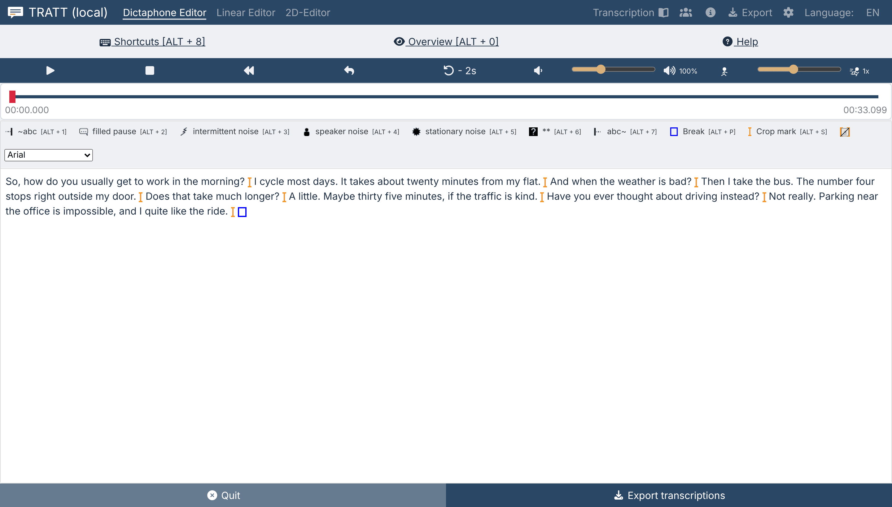
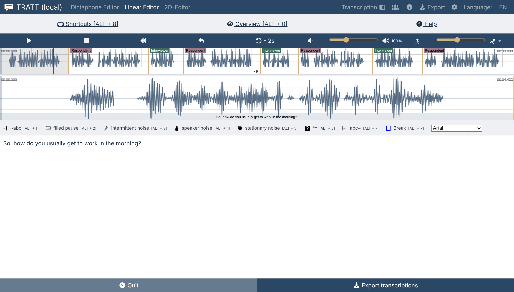

# The editors

**For:** anyone deciding how to work, or wondering why the screen looks different
from a colleague's.

Tratt offers several editors over the *same* transcript. Switching between them
does not change your data. You can move between them mid-file, as often as you
like, using the editor buttons in the header (in the [Workbench](workbench.md), the editor tabs above the editor).

The default view uses the **2D-Editor**.

---

## 2D-Editor

In this view, the recording is drawn as a waveform broken into lines, like text
wrapping, with each transcription unit shaded and its text printed underneath.

**Use it when** you need to see and change where units begin and end, which is most
of the time.

- Hover a unit and press **Enter** to open the **transcription window** for it.
- **S**, **A**, **D** and drag-select manage boundaries directly on the waveform
  ([How transcribing works](transcribing.md#boundaries)).
- **Seconds per line** in the Preferences controls how much audio each line holds.
- Turn on **Show magnifier** for a zoomed strip around the cursor when you need to
  place a boundary precisely.

### The transcription window

The pop-up you get with **Enter**. It shows one unit: its waveform with feedback on what is being played, a player,
the marker toolbar, and a text field.

- **Tab** / **Esc** play, pause and stop. Playing the unit for about 0.2 s marks
  it [verified](checking-your-work.md#verified-transcriptions).
- **Alt + ←** and **Alt + →** save and step to the previous or next unit; this is
  the fastest way through a file.
- **Alt + ↓** saves and closes.
- **Ctrl/Cmd + S** cycles the speaker label.
- If you loaded a video file and it is in a format the browser can play natively (MP4, WebM), the video
  is shown on top of the waveform.

---

## Dictaphone Editor

A player and a single text field. It does not show a waveform, and also no boundaries.

**Use it when** the recording is short, or the boundaries are already right and you
only want to type. It may also be the gentlest starting point for someone who has never
used an annotation tool.

Playback keys are the same as in the other editors: **Tab** play/pause, **Esc** stop,
**Shift + Backspace** back to the last start position, **Shift + Tab** step back in
time.

---

## Linear Editor

This is two signal displays stacked. The top display shows the whole recording, and a magnified view of the
current position is shown below.

**Use it when** you need fine control over boundary positions but want to see an overview of the file as a whole.

The two displays have separate playback keys, because you are usually working in one
while listening to the other:

| | Upper (overview) display | Lower (zoomed) display |
| --- | --- | --- |
| Play / pause | **Tab** | **Shift + Space** |
| Stop | **Esc** | **Esc** |
| Back to last position | **Shift + Backspace** | **Shift + Enter** |
| Step back in time | **Shift + Tab** | **Shift + \*** |

Boundary keys (**S**, **A**, **C**, **D**, **Enter**) work on whichever display the
mouse is over.

---

For a table-shaped view of your transcript, use the
[Overview window](checking-your-work.md) (**Alt + 0**), which lists every unit and
lets you edit and play rows in place.
