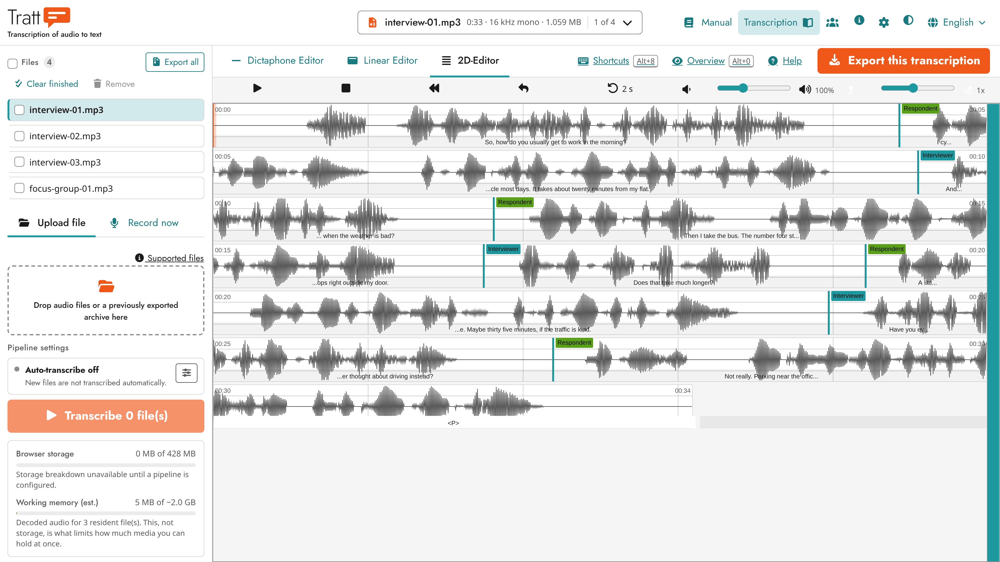

# The Workbench

**For:** anyone with a folder of recordings rather than a single file. The
Workbench transcribes a batch of files and lets you edit each result without
loading files one at a time.

> **How to get there.** On the start page, the header has a **Workbench** link
> next to **Manual**. It only shows in builds where the Workbench is enabled. You
> can also put `/workbench` in Tratt's address, for example
> `https://tratt.demo.humlab.umu.se/workbench`. A build from before the
> Workbench shipped sends that address to the ordinary start page instead.
>
> Once you are there, **Manual** in the header and **Help** next to the editor
> tabs both open this chapter rather than the manual's front page.

---

## When to use it, and when not

| | Start page (`/local`) | Workbench (`/workbench`) |
| --- | --- | --- |
| Recordings | One | Many |
| Automatic transcription | One run, you wait for it | A queue that works through the list |
| Switching between recordings | Reload the page, load the next file | Click a file in the list |
| Export | One file at a time | One file, or all of them as one archive |
| Best for | A single interview, a quick correction | A project's worth of material, an overnight batch |

Everything else is the same. The editors, the shortcuts, the markers, the tiers
and the export formats are the ones described in the rest of this manual. The
Workbench changes how material gets in and how you move between recordings, not
how you transcribe.

**They share one stored session.** Tratt keeps a single current recording in
browser storage, and the Workbench's file list uses the same slot. Starting a new
transcription on the start page can therefore replace a file that is in the
Workbench list, and Tratt warns you when it is about to. Pick one of the two ways
of working for a given piece of material and stay with it.

---

## Recording bundles

Each entry in the Workbench list is a **recording bundle**: a recording's audio
together with its transcript. The two parts behave differently:

- The **transcript** is saved in the browser as you work, and is still there
  when you come back.
- The **audio** is never saved. Tratt reads it from your computer while the page
  is open, so after a reload a recording bundle has its transcript but no audio
  until you attach the audio again.

The list shows both parts: the **Audio** column has a speaker when the audio is
attached and **Attach** when it is not, and the **Transcript** column says where
the transcript stands. In this manual, *file* means only a file on your
computer: one you drop, choose or download.

The name comes from the Emu database format, where a *bundle* is an audio file
together with the files that describe it.

---

## The layout

Four things sit on the left, from top to bottom:

1. **Recording bundles** with their number, and the buttons **Save as .zip**,
   **Delete done** and **Remove**.
2. The **Upload file** and **Record now** tabs over a drop area:
   *Drop audio or video files here, or a .zip saved from Tratt*. While a
   recording bundle is waiting for its audio, the drop area says that dropping
   that audio file attaches it.
3. **Transcription**: the transcription settings, whether new files are
   transcribed automatically, and — when some file is waiting — the button
   that starts the queue.
4. Two capacity meters: **Browser storage** and **Working memory (est.)**.

The rest of the window is the recording bundle you have selected in the list.
The list is the only place to switch between recording bundles; hover over one
to see its audio details.
Above the editor, one bar holds the editor tabs, **Shortcuts**, **Overview**,
**Help** and, at the right end, **Download transcript**. Below it is the
editor itself.

---

## Adding recordings

Drop as many audio or video files as you like on the drop area at once, or click
it and select them. Each file becomes its own entry in the list with its own
transcript. Formats and size limits are the same as everywhere else, listed under
[Loading a recording](loading-media.md#supported-file-formats).

**A transcript file** belongs with its recording: drop it together with the audio,
or after the audio is already in the list. Tratt pairs the two by name and tells
you when it cannot:

- *No recording named "x". Drop the transcript together with its audio file, or
  name it like the recording.*
- *Attach the audio of "x" first, then drop its transcript again.*
- Replacing a transcript that already has text asks for confirmation first,
  because your edits to it would be lost.

**Record now** records straight into the Workbench, exactly as on the start page.
See [Recording in the browser](loading-media.md#recording-in-the-browser).

### Loading an exported archive

Drop a `.zip` that Tratt exported earlier on the same drop area and it is
unpacked: each recording's audio and its `_annot.json` are then loaded back into the list,
paired up by the folder they sit in inside the archive. Two recordings that share
a file name (`take.wav` and `take.wma`) therefore keep their own transcripts. Loading an archive stops the queue and switches auto-transcription and
translation **off**, so restored material is not transcribed over.

Everything else in the archive (Word files, subtitles, the manifests) is output
and is ignored when loaded back into Tratt.

---

## Transcribing

The large orange **Transcribe** button, under the file list, is a
split button. Its left part starts transcription; its right part (the sliders
icon) opens the **Transcription settings**: the model, the transcription
language, speaker separation and local translation, described in
[Automatic draft transcription](automatic-transcription.md). Hover over the
sliders icon to see the current settings without opening them.

**Transcribe new files automatically** is a switch at the top of the settings.
When it is on, files are transcribed as they arrive: you can drop several
recordings and wait for them all to be processed. With nothing left to do, the
button then reads **Auto-transcribe on**.

When it is off, new recording bundles wait. The button reads **Transcribe N**
and runs the queue over every recording bundle that has no transcript yet,
skipping those whose audio is not attached. While the queue is
running, files are transcribed one at a time and the button becomes the run's
progress bar: *Transcribing 2 of 5*, filling up as the files are done. While a
file is prepared (its audio read, and the first time, its model loaded) its part
of the bar pulses. Clicking the button stops the run after you confirm: the file
in progress is cancelled, and the files still waiting are not transcribed.

The button can always be clicked. When there is nothing for it to do, it says
why, and its tooltip says so too.

### Transcribing a file again

To transcribe a file again, for example with a larger model or other settings,
tick it in the file list. The button then reads **Transcribe N selected**.
Files that already have a transcript are only transcribed again after you
confirm. Their current transcript is **replaced and cannot be restored**,
including any corrections you made, so use **Save as .zip** first if you want to
keep a copy. The confirmation says how many passages a person has already
corrected or checked by listening.

If you edit a file's transcript while it is being transcribed again, your edits
are kept and the new result is discarded.

---

## Watching it work

Each row in **Recording bundles** shows, in its **Transcript** column, where the
transcript stands:

| Status | Means |
| --- | --- |
| **Queued** | Waiting its turn |
| **Running** | Being worked on now, with the current stage and how far it has come, e.g. *Transcribing 40%* |
| **Done** | Finished |
| **Failed** | Stopped on an error, with **Retry** on the row |
| **Cancelled** | Stopped by you, with **Retry** on the row |
| **Has text** / **Not transcribed** | Never run: whether the transcript has any text yet (imported, or typed by hand) |
| **Interrupted** | The page was closed or reloaded part-way |

The button on the row stops that one recording bundle (*Stop transcribing this recording bundle*) and leaves the rest of the
queue alone.

A failed file says what went wrong (*Could not read the audio*,
*Could not load the model*, *Ran out of memory*, *Cancelled*, or simply *Failed*).
**Ran out of memory** means that the batch upploaded is too large for the available storage.
[Capacity](#capacity) below.

---

## Editing a result

Click a recording bundle in the list to open it. Hover over it to see its audio
details, for example `1:45 · 16 kHz mono · 3.4 MB`. When the audio is not
attached, they read *Audio not attached*, and **Attach audio…** sits next to
**Download transcript**.

From there you are in the ordinary editor. You select the 2D, Dictaphone, or Linear editor with the
editor tabs, and work as described in
[How transcribing works](transcribing.md). **Shortcuts** (Alt + 8) and
**Overview** (Alt + 0) are in the same bar as the tabs.

Playing a unit or editing its text marks it
[verified](checking-your-work.md#verified-transcriptions).

Edits are saved as you type, per recording bundle. Switching to another one in the list
does not make Tratt lose data.

---

## Coming back later

Tratt keeps your recording bundles' transcripts but never their audio. When you
return, a **Welcome back** panel greets you: *Tratt kept your transcripts from
last time, but not your audio: it never saves audio. To listen and correct,
attach each recording bundle's audio with "Attach" in the list, or drop the same
audio files here.* Pick the same file from disk (with **Attach** in the list,
**Attach audio…** in the header, or by dropping it) and editing continues where
you left off. Until then the editor says *This recording bundle's audio isn't
attached*, with an **Attach audio…** button.

If the file you pick does not look like the one the entry was made from, Tratt
stops to ask: *This doesn't look like the same audio*, with what you picked and
what it expected side by side, and **Use anyway**. When only the modification
time differs, Tratts indicates that, since that is usually a copy or re-exported audio rather
than the wrong recording.

You can also export an archive before you stop and
[load that back](#loading-an-archive) next time, which restores the audio and the
transcripts together and needs no re-attaching.

---

## Capacity

The two meters measure different things, and only one of them limits how much you
can have open.

**Browser storage** is what Tratt keeps on disk, which includes the downloaded models and your
transcripts. The note under it estimates both, for example *models ~210 MB for the
current pipeline + annotations ~221 MB*. **Media is never written to storage**,
which is why a folder of large recordings does not fill it up. Some browsers do
not report usage at all, and the indicator is then unavailable.

**Working memory (est.)** is decoded audio held in the tab. 
Every recording whose audio is attached occupies memory for as long as it
is attached. If you are near the budget, or a file fails with *Ran out of memory*,
work through the material in smaller groups,  export and
[Delete done](#housekeeping), then attach the next few.

---

## Getting results out

**One recording.** With a transcript on screen, the orange **Download
transcript** button at the right end of the bar with the editor tabs opens the usual export dialog, described in
[Exporting](exporting.md). It works even when the audio is not attached. It is
dimmed until there is something to export.

**All of them.** **Save as .zip** in the Files header opens a dialog of the same name:
tick the formats you want, and Tratt writes one archive containing every selected
recording, or all of them when you have ticked none. The button says which: with
three files ticked it reads **Save 3 as .zip**. Tratt reports progress, lists
any recordings it had to skip under *Completed with warnings*, and finishes with
*Done, N file(s) archived*.

What the archive contains, and how to load it back, is described in
[Exporting an archive](exporting.md#exporting-an-archive).

---

## Housekeeping

**Delete done** deletes the recording bundles marked *Done*, transcripts included. **Remove**
takes out the ones you have ticked, and the checkbox in the Files header ticks
them all. These actions cannot be undone.
