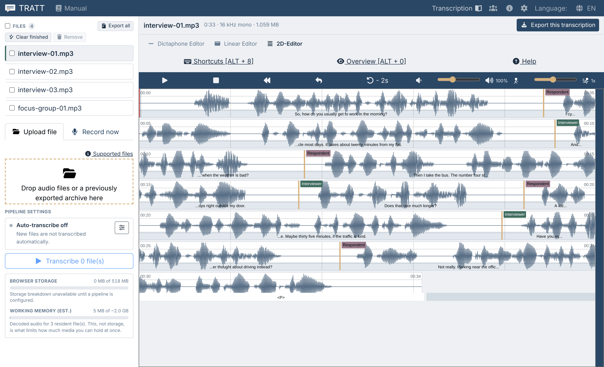

# The Workbench

**For:** anyone with a folder of recordings rather than a single file. The
Workbench transcribes a batch of files and lets you edit each result without
loading files one at a time.

> **How to get there.** The Workbench has no entry of its own in the navigation
> bar. You reach it by putting `/workbench` in Tratt's address, for example
> `https://tratt.demo.humlab.umu.se/workbench`. It is part of
> released builds; a build from before it shipped sends that address to the
> ordinary start page instead.
>
> Once you are there, **Manual** in the navigation bar and **Help** in the
> toolbar both open this chapter rather than the manual's front page.

---

## When to use it, and when not

| | Start page (`/local`) | Workbench (`/workbench`) |
| --- | --- | --- |
| Recordings | One | Many |
| Automatic transcription | One run, you wait for it | A queue that works through the list |
| Switching between recordings | Reload the page, load the next file | Click a file in the list |
| Export | One file at a time | One file, or all of them as one archive |
| Best for | A single interview, a quick correction | A project's worth of material, an overnight batch |

Everything else is the same. The editors, the shortcuts, the markers, the tiers
and the export formats are the ones described in the rest of this manual. The
Workbench changes how material gets in and how you move between recordings, not
how you transcribe.

**They share one stored session.** Tratt keeps a single current recording in
browser storage, and the Workbench's file list uses the same slot. Starting a new
transcription on the start page can therefore replace a file that is in the
Workbench list, and Tratt warns you when it is about to. Pick one of the two ways
of working for a given piece of material and stay with it.

---

## The layout

Four things sit on the left, from top to bottom:

1. **Files** with the number of recordings, and the buttons **Export all**,
   **Clear finished** and **Remove**.
2. The **Upload file** and **Record now** tabs over a drop area:
   *Drop audio files or a previously exported archive here*.
3. **Pipeline settings**: what happens to a file automatically, and the button
   that starts the queue.
4. Two capacity meters: **Browser storage** and **Working memory (est.)**.

The rest of the window is the recording you have selected: its name and details,
the editor switcher, the toolbar with **Shortcuts**, **Overview** and **Help**,
and the editor itself.

---

## Adding recordings

Drop as many audio or video files as you like on the drop area at once, or click
it and select them. Each file becomes its own entry in the list with its own
transcript. Formats and size limits are the same as everywhere else, listed under
[Loading a recording](loading-media.md#supported-file-formats).

**A transcript file** belongs with its recording: drop it together with the audio,
or after the audio is already in the list. Tratt pairs the two by name and tells
you when it cannot:

- *No recording named "x". Drop the transcript together with its audio file, or
  name it like the recording.*
- *Attach the audio of "x" first, then drop its transcript again.*
- Replacing a transcript that already has text asks for confirmation first,
  because your edits to it would be lost.

**Record now** records straight into the Workbench, exactly as on the start page.
See [Recording in the browser](loading-media.md#recording-in-the-browser).

### Loading an exported archive

Drop a `.zip` that Tratt exported earlier on the same drop area and it is
unpacked: each recording's audio and its `_annot.json` are then loaded back into the list,
paired up by the folder they sit in inside the archive. Two recordings that share
a file name (`take.wav` and `take.wma`) therefore keep their own transcripts. Loading an archive stops the queue and switches auto-transcription and
translation **off**, so restored material is not transcribed over.

Everything else in the archive (Word files, subtitles, the manifests) is output
and is ignored when loaded back into Tratt.

---

## The pipeline

**Pipeline settings** describes what will happen to a file when it
runs. With nothing configured it reads **Auto-transcribe off**, and *New files are
not transcribed automatically*. Click the sliders icon to open the settings.

The settings are the same controls as on the `https://tratt.demo.humlab.umu.se/local` start page. The user may select a transcription model, the
transcription language, speaker separation and local translation. They are
described in [Automatic draft transcription](automatic-transcription.md). Close
the dialog with **Done** and the summary line shows what you chose, for example:

> Auto-transcribe on · Whisper Medium · Swedish · 2 speakers · → English

**With auto-transcribe on, files are transcribed as they arrive.** You can drop
several recordings into the application and then wait for the processing to be performed on them all.

**With Auto-transcribe off**, nothing will happen until you press the button at the bottom of the
panel (**Transcribe N file(s)**) and runs the queue over the files that
have no transcript yet. While the queue is running the same button becomes
**Pause queue**; pausing lets the file in progress finish and holds the rest.

If the button is disabled, its tooltip explains why: *No transcription options
configured, enable auto transcription first.*

---

## Watching it work

Each row in **Files** shows the status of the recording with regards to the pipeline:

| Status | Means |
| --- | --- |
| **Queued** | Waiting its turn |
| **Running** | Being worked on now, with the current stage and a progress bar |
| **Done** | Finished |
| **Failed** | Stopped on an error, with **Retry** on the row |
| **Interrupted** | The page was closed or reloaded part-way |

The button on the row stops that one file (*Stop transcribing this file*) and leaves the rest of the
queue alone.

A failed file says what went wrong (*Could not read the audio*,
*Could not load the model*, *Ran out of memory*, *Cancelled*, or simply *Failed*).
**Ran out of memory** means that the batch upploaded is too large for the available storage.
[Capacity](#capacity) below.

---

## Editing a result

Click a recording in the list to open it. The header above the editor gives the media file
name and details, for example `interview_a.mp3 · 1:45 · 16 kHz mono · 3.369 MB`.

From there you are in the ordinary editor. You select the 2D, Dictaphone, or Linear editor in the
switcher, and work as described in
[How transcribing works](transcribing.md). **Shortcuts** (Alt + 8) and
**Overview** (Alt + 0) are in the toolbar. 

Playing a unit or editing its text marks it
[verified](checking-your-work.md#verified-transcriptions).

Edits are saved as you type, per recording. Switching to another file in the list
does not make Tratt lose data.

---

## Coming back later

Tratt will remembeer the list of media file names but never store the media files themselves. 
When you return, a **Welcome
back** panel greets you: *Your files from the last session are listed on the left.
Re-attach a file's audio with "Attach file…" to keep editing it, or drop new
files.*  Pick the same file
from disk and editing continues where you left off. Until then the editor says
*This file's audio isn't loaded in this session.*

If the file you pick does not look like the one the entry was made from, Tratt
stops to ask: *This doesn't look like the same file*, with what you picked and
what it expected side by side, and **Use anyway**. When only the modification
time differs, Tratts indicates that, since that is usually a copy or re-exported audio rather
than the wrong recording.

You can also export an archive before you stop and
[load that back](#loading-an-archive) next time, which restores the audio and the
transcripts together and needs no re-attaching.

---

## Capacity

The two meters measure different things, and only one of them limits how much you
can have open.

**Browser storage** is what Tratt keeps on disk, which includes the downloaded models and your
transcripts. The note under it estimates both, for example *models ~210 MB for the
current pipeline + annotations ~221 MB*. **Media is never written to storage**,
which is why a folder of large recordings does not fill it up. Some browsers do
not report usage at all, and the indicator is then unavailable.

**Working memory (est.)** is decoded audio held in the tab. 
Every recording whose audio is attached occupies memory for as long as it
is attached. If you are near the budget, or a file fails with *Ran out of memory*,
work through the material in smaller groups,  export and
[Clear finished](#housekeeping), then attach the next few.

---

## Getting results out

**One recording.** With a transcript on screen, **Export this transcription** in
the header opens the usual export dialog, described in
[Exporting](exporting.md). It works even when the audio is not attached. It is
hidden until there is something to export.

**All of them.** **Export all** in the Files header opens **Export catalogue**, 
tick the formats you want, and Tratt writes one archive containing every selected
recording, or all of them when you have ticked none. It reports progress, lists
any recordings it had to skip under *Completed with warnings*, and finishes with
*Done, N file(s) archived*.

What the archive contains, and how to load it back, is described in
[Exporting an archive](exporting.md#exporting-an-archive).

---

## Housekeeping

**Clear finished** takes the completed recordings out of the list. **Remove**
takes out the ones you have ticked, and the checkbox in the Files header ticks
them all. These actions cannot be undone.
