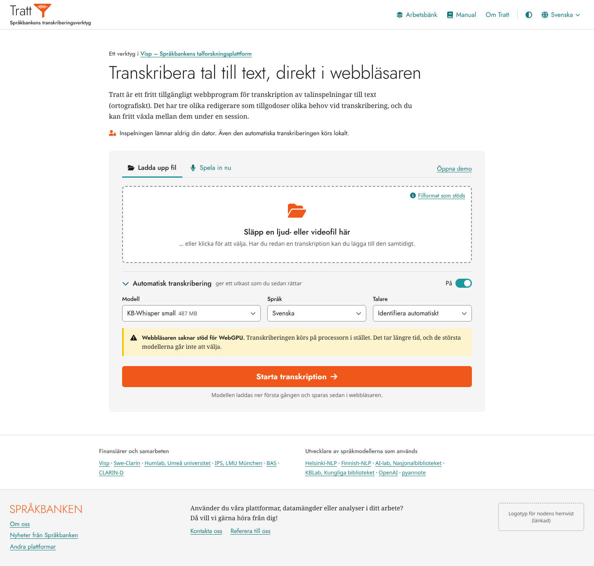
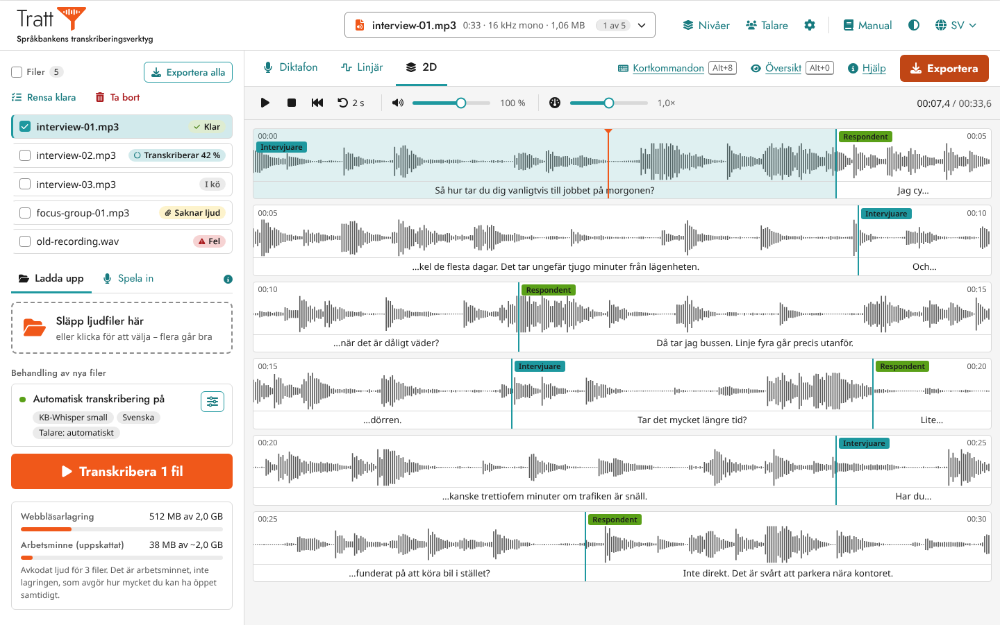
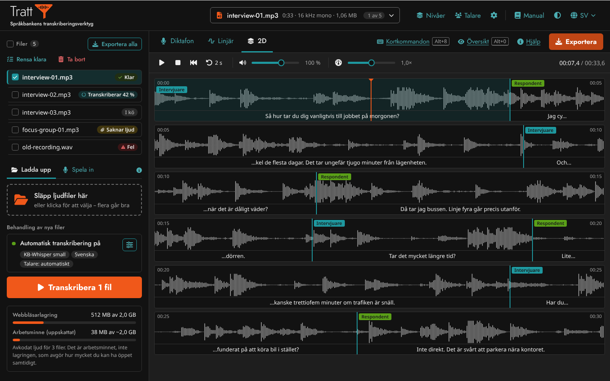
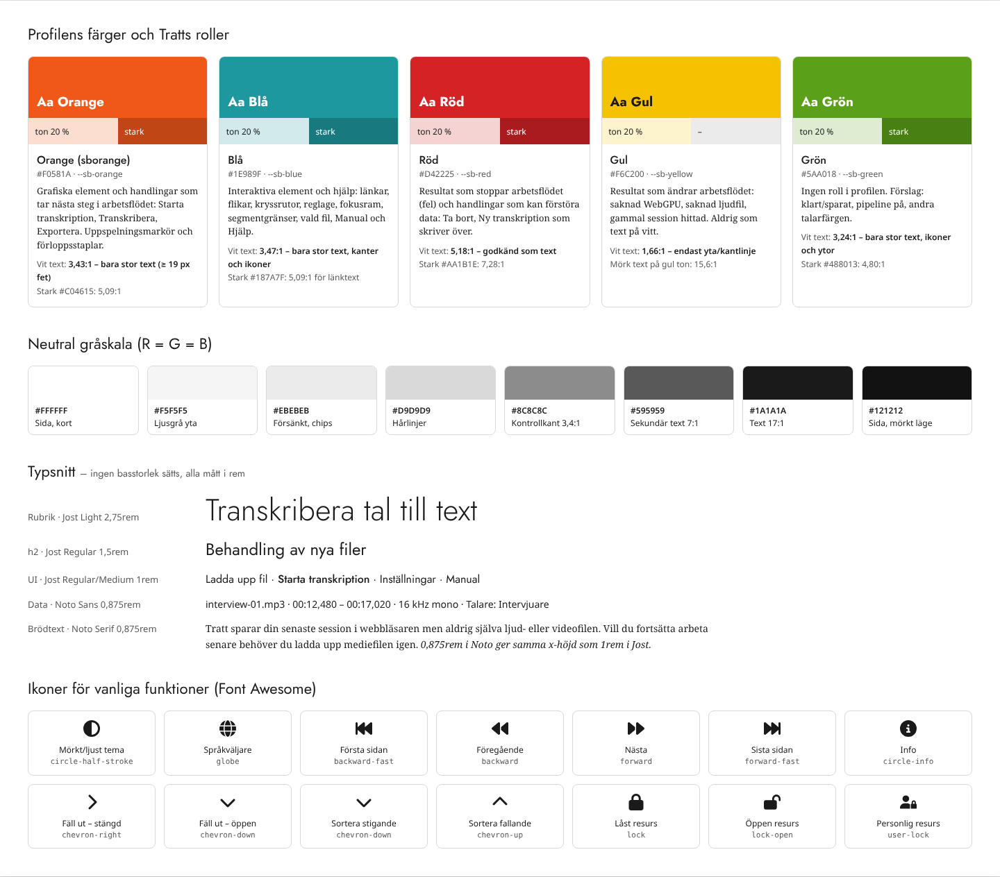

# Tratt enligt Språkbankens grafiska profil – design och plan

**Datum:** 2026-10-12 · **Status:** förslag, väntar på besluten i avsnitt 9
**Omfattning:** Hela applikationen (alla rutter, dialoger och inbäddningen i Visp) och manualens webbplats.
**Underlag:** Språkbankens grafiska profil (avsnitten Grunder och Frontend, WIP 2026-) och logotyperna i [spraakbanken/communication](https://github.com/spraakbanken/communication/tree/main/logotypes).
**Skiss:** [`reference/sprakbanken-profil/tratt-sprakbanken-profil.html`](reference/sprakbanken-profil/tratt-sprakbanken-profil.html). Öppna den i en webbläsare. Skärmbilderna nedan är tagna från den.
**Implementeringsplan:** [`../plans/2026-10-12-sprakbanken-grafisk-profil.md`](../plans/2026-10-12-sprakbanken-grafisk-profil.md). Utvidgning till alla ingångar: [`../plans/2026-10-27-sprakbanken-profil-alla-ingangar.md`](../plans/2026-10-27-sprakbanken-profil-alla-ingangar.md).

Utanför omfattningen: `apps/translations` och Typedoc-sidorna, se beslut 12 och 16 i `plans/2026-10-27-…`.

---

## 1. Sammanfattning

- Den marinblå navigeringsraden och den stora blå bannern på `/local` ersätts av ett **vitt sidhuvud enligt profilen**: Tratts logotyp med slogan till vänster, dataväljare i mitten och meny till höger.
- `/local` får **Språkbankens standardsidfot**. Erkännandena av finansiärer och modellutvecklare flyttas till en diskret tackrad ovanför sidfoten. `/workbench` får ingen sidfot, vilket är ett avsteg (se beslut 4).
- Alla färger går över till **profilens fem färger med de roller profilen anger**: orange för nästa steg, blå för interaktion och hjälp, röd för fel och förstörande handlingar och gul för avvikelser. Den blågrå skalan från Visp och Umeå universitet ersätts av **neutral gråskala**.
- **Jost\*** används för rubriker och UI, **Noto Sans** för data och **Noto Serif** för brödtext. Typsnitten **självhostas**, eftersom Tratt lovar att ingenting skickas till externa servrar.
- **Mörkt läge** införs med en växlare (`circle-half-stroke`). Tokens byggs för båda lägena från början.
- Allt ska klara **WCAG 2.1 AA**, som gäller för universitetens webbtjänster enligt lagen om tillgänglighet till digital offentlig service. Det kräver några tolkningar av profilen, se 3.2. Bytet rättar samtidigt tre kontrastfel som finns i dag: varningsrutan har ljus text på guld (1,76:1), den orange CTA-knappen har 3,2:1 och den sekundära texten 3,87:1.

## 2. Skisser

**`/local`, ljust läge.** Sidhuvud, introduktion, arbetskort (uppladdning, automatisk transkribering, gul avvikelse, orange nästa steg), tackrad och Språkbankens sidfot.

**`/workbench`, ljust läge.** Dataväljaren i sidhuvudet tar över filnamnet från redigerarens rubrikrad. Statusarna i fillistan följer färgrollerna.

**`/workbench`, mörkt läge.** Samma markup. Bara tokens byts.

**Färger, typsnitt och ikoner** som de används i Tratt:

---

## 3. Färger

### 3.1 Roller

| Profilfärg        | Värde     | Roll i profilen                                                         | Används i Tratt för                                                                                                                      |
| ----------------- | --------- | ----------------------------------------------------------------------- | ---------------------------------------------------------------------------------------------------------------------------------------- |
| Orange (sborange) | `#F0581A` | Grafiska element, handlingar som tar nästa steg i ett tänkt arbetsflöde | _Starta transkription_, _Transkribera N filer_, _Exportera_; uppspelningsmarkören, förloppsstaplar, ikonen i släppytan och Tratts symbol |
| Blå               | `#1E989F` | Interaktiva element, hjälpavsnitt                                       | Länkar, flikar, kryssrutor, reglage, fokusram, segmentgränser, vald fil, _Manual_, _Hjälp_, _Filformat som stöds_                        |
| Röd               | `#D42225` | Resultat som stoppar arbetsflödet, handlingar som kan förstöra data     | Felstatus, felmeddelanden, _Ta bort_, _Ny transkription_ (skriver över den sparade sessionen)                                            |
| Gul               | `#F6C200` | Resultat som förändrar arbetsflödet. Undvik som text på vitt            | WebGPU saknas, ljudfil saknas (_Saknar ljud_), gammal session hittad, diariseringsvarning                                                |
| Grön              | `#5AA018` | _(ingen roll anges)_                                                    | Förslag: klar/sparad, pipeline påslagen, andra talarfärgen (beslut 7)                                                                    |

Det som i dag är `btn-success` (9 rubrik-CTA) blir orange "nästa steg". Det som är `btn-primary` (55 vardagsknappar) blir blått, oftast i konturvariant. `btn-danger` förblir rött. Den marinblå "kromen" (`--tratt-chrome`) försvinner helt. Navigeringsraden, ljudspelarens verktygsrad och förloppsstaplarna blir vita eller ljusgrå, enligt regeln att undvika färgad bakgrund till text.

### 3.2 Kontrast: hur profilen följs och samtidigt klarar WCAG AA

Uppmätta kontrastvärden (WCAG 2.1, beräknade):

|                  | mot vitt | mot `#121212` (mörkt) | slutsats                                                |
| ---------------- | -------- | --------------------- | ------------------------------------------------------- |
| Orange `#F0581A` | 3,43:1   | 5,46:1                | Vit text bara som _stor text_ (≥ 19 px fet). Grafik ok. |
| Blå `#1E989F`    | 3,47:1   | 5,39:1                | Ok för kanter och ikoner, inte för länktext på vitt     |
| Röd `#D42225`    | 5,18:1   | 3,62:1                | Ok som text i ljust läge, behöver ljusas upp i mörkt    |
| Gul `#F6C200`    | 1,66:1   | 11,27:1               | Aldrig som text eller ensam ikon på vitt                |
| Grön `#5AA018`   | 3,24:1   | 5,78:1                | Grafik och ytor, inte text på vitt                      |

Varianterna härleds med samma blandningsregel som profilen redan använder för toner, så att ingen behöver handplocka hex-värden. Varianterna skrivs med `color-mix()` i tokenfilen:

- **Ton** = 20 % färg + 80 % vitt (ljust läge) eller 80 % sidbakgrund (mörkt läge). Det är profilens "80:20 med helvitt". Används bara som bakgrund.
- **Stark** = 80 % färg + 20 % svart. Ger orange `#C04615` (5,09:1), blå `#187A7F` (5,09:1), röd `#AA1B1E` (7,28:1) och grön `#488013` (4,80:1).

Reglerna som följer av det:

1. **Stora orange knappar** (_Starta transkription_, _Transkribera N filer_) har ren sborange och vit text i fetstil, minst `1.1875rem`. Det räknas som stor text, där 3:1 räcker. Det följer också profilens regel om fetstil på färgad bakgrund. **Mindre orange knappar** (_Exportera_) har den starka varianten.
2. **Länkar och blå knapptext** använder stark blå. Ren blå används för kanter, fokusram, reglage och ikoner (3:1 räcker för grafik).
3. **Text på en ton** har alltid vanlig textfärg. Färgen bärs av ytan och ikonen. Stark grön på grön ton ger bara 3,9:1, så statusetiketter som _Klar_ får svart text och grön bock.
4. **Gul** förekommer bara som ton med en gul kantlinje och mörk ikon och text, aldrig som ikon eller text direkt på vitt.
5. **Kontrollers kanter** (fält, kryssrutor, släppytans streckade ram) använder `#8C8C8C` (3,36:1). Hårlinjer som bara delar av ytor använder `#D9D9D9`.

### 3.3 Neutral gråskala och mörkt läge

Gråskalan är neutral (R = G = B):

| Token              | Ljust     | Mörkt     | Användning                                             |
| ------------------ | --------- | --------- | ------------------------------------------------------ |
| `--surface-page`   | `#FFFFFF` | `#121212` | Sida, kort, rader i redigeraren                        |
| `--surface-subtle` | `#F5F5F5` | `#1E1E1E` | Arbetskort, sidfot, verktygsrad, redigerarens bakgrund |
| `--surface-sunken` | `#EBEBEB` | `#2A2A2A` | Chips, räknare, stapelspår                             |
| `--border`         | `#D9D9D9` | `#333333` | Hårlinjer                                              |
| `--border-control` | `#8C8C8C` | `#6B6B6B` | Kanter på kontroller (≥ 3:1)                           |
| `--text`           | `#1A1A1A` | `#EDEDED` | Text (17:1 och 16:1)                                   |
| `--text-muted`     | `#595959` | `#A6A6A6` | Sekundär text (7,0:1 och 6,9:1)                        |

I mörkt läge används profilfärgerna som de är för grafik. Länktext blir blå blandad med vitt (`#4BADB2`, 6,3:1), och röd text blir `#E16466` (4,8:1 på mörk röd ton).

---

## 4. Typografi

| Användning                                                                                       | Typsnitt   | Vikt                                  | Storlek                           |
| ------------------------------------------------------------------------------------------------ | ---------- | ------------------------------------- | --------------------------------- |
| Sidrubrik (h1)                                                                                   | Jost\*     | Light 300                             | `2.75rem`                         |
| h2                                                                                               | Jost\*     | Regular 400                           | `1.5rem` (profilens förslag)      |
| h3, kortrubriker                                                                                 | Jost\*     | Medium 500                            | `1.0625–1.1875rem`                |
| UI: knappar, menyer, flikar, etiketter, fält                                                     | Jost\*     | 400 / 500, CTA 700                    | `1rem`, små etiketter `0.8125rem` |
| Tabeller och data: filnamn, tider, metadata, chips, transkriptionstext, tidsetiketter i kanvasen | Noto Sans  | 400 / 600, `tabular-nums` för siffror | `0.875rem`                        |
| Brödtext: introduktion, hjälptexter, meddelanden                                                 | Noto Serif | 400, kursiv 400                       | `0.875rem`                        |

- **Ingen basstorlek sätts** och alla textstorlekar anges i `rem`. I dag finns 22 `font-size` i `px` i appen och `ngx-components` (t.ex. sidfoten med `10px` och etiketterna med `11px`). De byts.
- **Noto ska vara mindre än Jost**, men profilens "0,8rem" är för snålt. x-höjden är 0,536 em i Noto och 0,46 em i Jost, så Noto i `0.875rem` har samma x-höjd som Jost i `1rem`. `0.8rem` ger 12,8 px brödtext med standardinställningen i webbläsaren. Vi föreslår `0.875rem` (beslut 6).
- **Självhostning.** Typsnitten får inte hämtas från Google Fonts eller något annat CDN, eftersom Tratt lovar att ingenting går till externa servrar när appen väl är öppnad. Förslaget är `@fontsource/jost`, `@fontsource/noto-sans` och `@fontsource/noto-serif`. Delmängderna latin och latin-ext räcker för en, sv, de, nl och it. Uppmätt storlek: Jost 300/400/500/700 latin och latin-ext, Noto Sans 400/600 latin och Noto Serif 400 normal och kursiv latin blir tillsammans **ca 124 KB woff2**. För ko och zh faller texten tillbaka på systemets typsnitt via `unicode-range`. Det duger för UI. Transkriptionstext på andra skriftsystem ritas med systemets typsnitt.
- **Servicearbetaren.** Typsnitt som refereras från CSS hamnar i `media/` i bygget, och den katalogen cachas inte av `apps/tratt/ngsw-config.json` (där finns bara `/*.css`, `/*.js`, `/assets/**` …). Kopiera därför woff2-filerna till `assets/fonts/` med en assets-glob i `project.json`, och skriv egna `@font-face` med `font-display: swap`. Förladda Jost 400 och Noto Sans 400 i `index.html`.
- **Kanvasen** ritar i dag text i Arial i `9 px` (`audio-viewer.config.ts`). Den byts till Noto Sans och ritas först efter `document.fonts.load()`, annars blir första ritningen i reservtypsnittet.

---

## 5. Sidhuvud och sidfot

### 5.1 Sidhuvud (alla vyer i omfattningen)

Vitt med en hårlinje i underkant och höjden `4.5rem`. Höjden blir en token som ersätter dagens hårdkodade `margin-top: 40px` på `<main>` i `app.component.html`.

| Del                      | `/local`                                                                                                                  | `/workbench`                                                                                                                                                                                                           |
| ------------------------ | ------------------------------------------------------------------------------------------------------------------------- | ---------------------------------------------------------------------------------------------------------------------------------------------------------------------------------------------------------------------- |
| **Vänster**              | Tratts logotyp med slogan, länkad till `/local`                                                                           | samma, länkad till `/workbench`                                                                                                                                                                                        |
| **Mitten (dataväljare)** | tom (se beslut 9)                                                                                                         | Den aktiva filen: namn, längd, format, storlek och "1 av 5", med `chevron-down`. Öppnar fillistan. På smala skärmar är det enda vägen till listan när vänsterspalten är hopfälld. Ersätter `workbench__editor-header`. |
| **Höger**                | _Arbetsbänk_ (om aktiverad), _Manual_, _Om Tratt_, temaväljare (`circle-half-stroke`), språkväljare (`globe` + språknamn) | _Nivåer_, _Talare_, inställningar (`gear`), _Manual_, tema, språk                                                                                                                                                      |

- Texten "Language:" försvinner. Glob-ikonen och språknamnet räcker.
- _GitHub_ flyttas från menyn till dialogen _Om Tratt_.
- Den röda "beta"-märkningen (röd = fel enligt profilen) blir en neutral etikett bredvid logotypen.
- Logga in finns inte i det lokala läget. Platsen i menyn finns kvar för `/login`, som är utanför omfattningen.
- Under `md` fälls menyn ihop bakom en knapp. Logotypen behåller sin slogan ner till `sm` och visar därefter bara namn och symbol.

### 5.2 Sidfot (`/local`)

Språkbankens standardsidfot på ljusgrå yta:

- **Vänster:** Språkbankens logotyp, länkad till <https://sprakbanken.se/>, och länkarna _Om oss_ (`/om`), _Nyheter från Språkbanken_ (`/aktuellt`) och _Andra plattformar_ (`/plattformar`).
- **Mitten:** "Använder du våra plattformar, datamängder eller analyser i ditt arbete? Då vill vi gärna höra från dig!" följt av _Kontakta oss_ (`/kontakt`) och _Referera till oss_ (`/om/referera-till-oss`).
- **Höger:** logotypen för nodens hemvist, länkad (beslut 3).

Texterna läggs i Transloco under ett nytt nyckelträd `footer.*` i `sv.json` och `en.json`. Övriga språk faller tillbaka på engelska.

Ovanför sidfoten finns en **tackrad** med _Finansiärer och samarbeten_ och _Utvecklare av språkmodellerna som används_. Det är samma innehåll som de två `fieldset`-blocken i dag, men som textlänkar i Noto Sans i stället för logotyper (beslut 5).

---

## 6. `/local`

Ändringarna gäller `login.component.html` och `login.component.scss`, grenen `localOnly`.

1. **Den inlinade SVG-bannern tas bort** (`#1F4477`, Archivo och IBM Plex Mono). Logotypen finns redan i sidhuvudet. I stället kommer en raden "Ett verktyg i Visp – Språkbankens talforskningsplattform", en h1 i Jost Light ("Transkribera tal till text, direkt i webbläsaren") och appbeskrivningen i Noto Serif.
2. **Integritetslöftet** blir en egen rad med ikonen `user-lock` ("personlig resurs" i profilens ikonlista): "Inspelningen lämnar aldrig din dator. Även den automatiska transkriberingen körs lokalt."
3. **Arbetskortet** får ljusgrå yta (`--surface-subtle`) och ingen skugga. Flikarna _Ladda upp fil_ och _Spela in nu_ har blå text, och den aktiva fliken har blå understrykning. _Öppna demo_ blir en vanlig blå länk till höger i flikraden. De inlinade `style="color: #000"` på flikarna tas bort.
4. **Släppytan** (`drop-zone.component.scss`, `tratt-dropzone.component.scss`) får vit yta, en streckad grå kant (`--border-control`) i stället för dagens guldfärgade och en orange mappikon. Vid drag-över blir kanten blå och ytan får blå ton.
5. **Automatisk transkribering** blir ett fällbart avsnitt med `chevron-right`/`chevron-down` enligt profilen och en blå växlare. Fälten har Jost och grå kontrollkanter.
6. **Avvikelser** (WebGPU saknas, gammal session hittad, diariseringsvarning) visas som gul ton med gul vänsterkant och mörk text. Det ersätter dagens `.alert-warning` med ljus text på guld (1,76:1).
7. **Nästa steg** är en stor orange knapp i full bredd (_Starta transkription_ eller _Manuell transkription_, enligt `offlineSubmitLabelKey()`). _Ny transkription_ (`offline-delete-btn`) förblir röd eftersom den skriver över sessionen.
8. **Förloppspanelerna** för transkribering och översättning har i dag `bg-light`, `bg-success` och `bg-info` och får neutral ljusgrå yta med orange staplar. _Avbryt_ blir en neutral konturknapp och fel visas i röd ton.

## 7. `/workbench` och redigerarna

**Vänsterspalten** (`workbench.component.*`, `bundle-list.component.scss`, `capacity-indicator.component.scss`):

- Avsnittsetiketterna har Jost Medium `0.8125rem` i gemener, i stället för versaler i `11px`.
- I fillistan har den valda filen blå vänsterkant och blå ton. Statusetiketterna har ton, ikon och svart text: _Klar_ är grön, _Transkriberar 42 %_ blå, _I kö_ grå, _Saknar ljud_ gul och _Fel_ röd. Dagens handblandade `#fbeed9`/`#8a5a1f` och `#e2ede8` ersätts av tokens.
- _Exportera alla_ är en blå konturknapp, _Rensa klara_ en blå textknapp och _Ta bort_ en röd textknapp.
- Pipelinekortet har en grön punkt när det är påslaget och grå när det är avslaget, chips med neutral grå ton och en blå konturknapp med `sliders`. _Transkribera N filer_ blir den stora orange knappen, och _Pausa_ blir neutral.
- Kapacitetsindikatorns lagringsstapel är orange för modeller och mörkgrå för transkriptioner. Minnesstapeln är grön, gul och röd vid samma trösklar som i dag (55 % och 80 % av minnesbudgeten).

**Högerpanelen:**

- Rubrikraden med filnamn och metadata flyttas till dataväljaren i sidhuvudet. Kvar blir en rad med redigerarflikarna (_Diktafon_, _Linjär_, _2D_), länkarna i `tratt-fastbar` (_Kortkommandon_, _Översikt_, _Hjälp_, i blått som hjälpavsnitt, med `kbd` för kortkommandona) och _Exportera_ i stark orange. Det sparar en rad.
- Ljudspelarens verktygsrad (`audio-navigation.component.css`, i dag vit text på `--tratt-accent-green`, alltså marinblått) blir ljusgrå med mörka ikoner. Volym och hastighet har blå reglage.

**Signalvisningen** (`libs/ngx-components/.../audio-viewer*`, `audioplayer.component.ts`, `tratt-colors.ts`, `speaker-colors.ts`):

| Element                                | I dag                                  | Nytt                                                                                               |
| -------------------------------------- | -------------------------------------- | -------------------------------------------------------------------------------------------------- |
| Vågform                                | `rgba(42,71,101,.8)`                   | `--wave`, neutral grå (`#595959` / `#A6A6A6`)                                                      |
| Uppspelningsmarkör                     | crimson `#D7263D`                      | sborange. Röd är reserverad för fel.                                                               |
| Segmentgränser                         | guld `#D7B17C`                         | blå. De är interaktiva och kan dras.                                                               |
| Valt segment                           | –                                      | blå ton, 14 %                                                                                      |
| Transkriberat segment                  | `rgba(60,98,137,.15)`                  | neutral grå 5 %                                                                                    |
| Talaretiketter                         | palett ur Umeå universitets profil     | blå, grön och sedan neutrala och tonade varianter, med svart text. Ingen röd eller gul. (beslut 8) |
| Ramar och bakgrund i renderer-tjänsten | hårdkodat `#ffffff`, `#000000`, `gray` | tokens                                                                                             |

`TRATT_COLORS` är i dag en konstant som inte kan följa ett temabyte. Den görs om till en tjänst som läser CSS-variablerna via `getComputedStyle` vid start och vid temabyte och sedan ritar om. Det krävs för mörkt läge.

## 8. Ikoner och benämningar

Font Awesome Free används redan (`@fortawesome/fontawesome-free` ^7.3.1). Profilens lista mappas så här:

| Funktion                           | Ikon                                                      | Var i Tratt                                                                                                                                                                                                            |
| ---------------------------------- | --------------------------------------------------------- | ---------------------------------------------------------------------------------------------------------------------------------------------------------------------------------------------------------------------- |
| Mörkt/ljust tema                   | `circle-half-stroke`                                      | ny, i sidhuvudet                                                                                                                                                                                                       |
| Språkväljare                       | `globe`                                                   | finns, texten "Language:" tas bort                                                                                                                                                                                     |
| Fäll ut (stängd/öppen)             | `chevron-right` / `chevron-down`                          | automatisk transkribering, inställningsavsnitt (används redan på 7 + 7 ställen)                                                                                                                                        |
| Första/föregående/nästa/sista sida | `backward-fast` / `backward` / `forward` / `forward-fast` | Används inte i `/local` eller `/workbench` i dag. Sidnumrering finns bara i projektlistan, som är utanför omfattningen. Ljudspelarens `backward` betyder "spola tillbaka". Det är en mediekonvention och kan stå kvar. |
| Sortera stigande/fallande          | `chevron-down` / `chevron-up`                             | om fillistan blir sorterbar                                                                                                                                                                                            |
| Personlig resurs                   | `user-lock`                                               | integritetsraden på `/local`                                                                                                                                                                                           |
| Info                               | `circle-info`                                             | _Filformat som stöds_, _Hjälp_                                                                                                                                                                                         |

Dagens `fa-caret-down` (1 ställe) byts till `chevron-down`.

**Benämningar:**

- **TRATT → Tratt**, i linje med Korp, Mink och Visp. Det gäller 20 förekomster i `en.json` och 21 i `sv.json`, `<title>`, `manifest.json` och metataggarna i `index.html` (beslut 2). Repot och README kan behålla sitt namn.
- **VISP → Visp** och **"Språkbanken"**, aldrig "SB".
- `branding.tagline` ("transkription av tal till text") ersätts av sloganen från beslut 1.

---

## 9. Beslut som behövs

| #   | Fråga                                                                                                                              | Förslag                                                                                                                                                                                                                                                                                                             | Vem                                                                                  |
| --- | ---------------------------------------------------------------------------------------------------------------------------------- | ------------------------------------------------------------------------------------------------------------------------------------------------------------------------------------------------------------------------------------------------------------------------------------------------------------------- | ------------------------------------------------------------------------------------ |
| 1   | **Tratts logotyp och slogan.** Tratt finns inte i profilens lista över verktyg och plattformar.                                    | En logotyp i samma familj som Korp, Mink och Visp: "Tratt" i Jost Light och en orange tratt-symbol där ljud går in, i linje med Visps visp och vågform. Sloganen sätts i Jost Medium, t.ex. "Språkbankens transkriberingsverktyg" eller "Ett transkriberingsverktyg i Visp". Symbolen i skissen är en platshållare. | Språkbankens kommunikation (kontaktperson enligt communication-repot: Staffan Melin) |
| 2   | Namnform **TRATT → Tratt**                                                                                                         | Ja, i UI och metadata                                                                                                                                                                                                                                                                                               | Teamet                                                                               |
| 3   | **Nodens hemvist** i sidfoten och logotypfil                                                                                       | Bekräfta vilken nod Visp och Tratt hör till och skaffa logotypen. Communication-repot har bara Göteborgs universitets.                                                                                                                                                                                              | Teamet med Språkbanken                                                               |
| 4   | **Ingen sidfot på `/workbench`**                                                                                                   | Ja. Arbetsbänken är en arbetsyta i fönstrets höjd utan sidrullning, och sidfotens länkar finns i _Om Tratt_. Stäm av avsteget med profilens ägare.                                                                                                                                                                  | Språkbanken                                                                          |
| 5   | **Partner- och modellerkännanden** som text i stället för logotyper                                                                | Ja på `/local`. Kontrollera först att inga avtal (t.ex. med finansiärer eller CLARIN-D) kräver logotypen.                                                                                                                                                                                                           | Teamet                                                                               |
| 6   | Brödtext i **`0.875rem`** i stället för profilens `0.8rem`                                                                         | `0.875rem` (samma x-höjd som Jost i 1rem). Profilen är WIP, så återkoppla.                                                                                                                                                                                                                                          | Språkbanken                                                                          |
| 7   | **Grön** saknar roll i profilen                                                                                                    | Klar/sparad, påslaget och andra talarfärgen                                                                                                                                                                                                                                                                         | Språkbanken                                                                          |
| 8   | **Talarfärger**                                                                                                                    | Blå, grön, neutral mörkgrå och därefter toner. Undvik röd och gul eftersom de har betydelse i UI:t.                                                                                                                                                                                                                 | Teamet                                                                               |
| 9   | **Dataväljaren på `/local`**                                                                                                       | Lämna mitten tom tills vidare. Senare kan den bli en lägesväxlare ("En inspelning" / "Arbetsbänk") om arbetsbänken blir standard.                                                                                                                                                                                   | Teamet                                                                               |
| 10  | **Samordning med Visps webbklient.** Tratt visas inuti Visp, och dagens tokens speglar avsiktligt Visps (`styles.scss`, rad 4–13). | Byt samtidigt i Visp eller dela tokenfilen, annars blir inbäddningen visuellt splittrad                                                                                                                                                                                                                             | Visp-teamet                                                                          |

---

## 10. Genomförande i faser

Grova uppskattningar för en utvecklare som känner kodbasen. Faserna 1–2 måste göras först. Faserna 3–5 kan sedan göras parallellt.

**Fas 0 – Beslut och material** (kalendertid, inte utvecklingstid). Besluten i avsnitt 9, logotypfiler i SVG (Tratt, Språkbanken, noden) och sloganen på sv och en.

**Fas 1 – Grund: tokens och typsnitt** (2–3 dagar)

- Dela upp `apps/tratt/src/styles.scss` (675 rader) i `styles/_sb-tokens.scss` (brand, toner, starka varianter, gråskala, ljust och mörkt), `styles/_bootstrap.scss` och `styles/_typography.scss`.
- Konfigurera Bootstrap 5.3 med Sass-variabler (`$primary` = blå, `$danger`, `$warning`, `$success`, `$font-family-base`, `$headings-font-family`, `$border-radius` …) i stället för precompilerade värden plus `!important`-overrides. Lägg till en egen knappvariant, `.btn-next` och `.btn-next-lg`, för orange.
- Behåll de gamla tokennamnen (`--tratt-chrome`, `--tratt-cta`, `--tratt-accent-*` …) som tillfälliga alias till de nya, så att komponenter som ännu inte konverterats inte går sönder. Ta bort aliasen i fas 7.
- Lägg till typsnittspaket, assets-glob och `@font-face`. Lägg till förladdning i `index.html`. Laddningsskärmen i `index.html` får nya färger, ny logotyp och ny förloppsstapel.
- Uppdatera `manifest.json` (`theme_color` `#2a4765` → vitt eller orange enligt beslut, `background_color`) och favicon.

**Fas 2 – Skal: sidhuvud och sidfot** (2–3 dagar)

- `navbar.component.html` (984 rader) blandar skalet med redigerarens menyer (nivåer, talare, inställningar, export). Behåll `NavigationComponent` och dess menyer, men byt skalet runt dem: vänster, mitten och höger. Mitten fylls av sidan som visas, genom att sidan lånar ut en mall. Behåll `NavbarService` som den är. `workbench.component.spec.ts` mockar navbar-modulen och påverkas inte.
- Bygg en ny fristående `tratt-footer` och en tackrad, och lägg dem i `LoginComponent` där de gamla `fieldset`-blocken låg. Det är den komponentens värdelement som rullar.
- Kontrollera att sidhuvud och sidfot inte visas i Visp-inbäddningen (`/visp-task/...`, `LoginMode.URL`), där Visp står för ramen.

**Fas 3 – `/local`** (2 dagar). Allt i avsnitt 6. Byt ut 19 hårdkodade färger i `login.component.html` och inlinade stilar på flikar och `fieldset`. Färgerna på nivåmätaren i `recording-panel.component.scss` (`#2ecc71`, `#f39c12`, `#e74c3c`) byts till grön, gul och röd token.

**Fas 4 – `/workbench`** (2–3 dagar). Allt i avsnitt 7, vänsterspalten och högerpanelens rader. Byt ut 21 hårdkodade färger i `workbench.component.scss`, 25 i `bundle-list.component.scss` och 10 i `capacity-indicator.component.scss`. Flytta filrubriken till dataväljaren.

**Fas 5 – Redigerare och kanvas** (3–4 dagar). Signalvisningen enligt tabellen i avsnitt 7: temaberoende `TRATT_COLORS`, kanvastypsnitt efter `document.fonts.load()`, talarpalett och ljudspelarens verktygsrad. Kontrollera alla tre redigerarna och popup-redigeraren, eftersom de delar komponenterna.

**Fas 6 – Mörkt läge** (2–3 dagar)

- Lägg `data-bs-theme` på `<html>`. Standard följer `prefers-color-scheme`, och växlaren sparar valet i `localStorage` (bara en bekvämlighet).
- Kanvasen ritas om vid byte.
- Tredjeparts-CSS behöver ses över: Jodit har ett eget mörkt tema, och video.js måste kontrolleras.

**Fas 7 – Verifiering och städning** (1–2 dagar). Se avsnitt 12. Ta bort aliasen och de sista hårdkodade färgerna (97 i 18 filer i appen och `ngx-components` i dag), och ta nya skärmbilder.

Totalt ungefär **14–20 utvecklardagar** utöver fas 0.

## 11. Risker

- **Kanvasfärgerna är statiska.** Utan fas 5 fungerar inte mörkt läge i redigerarna. Om fas 5 dröjer kan växlaren vänta.
- **Sidhuvudet rör redigerarens flöden.** Menyerna för nivåer och talare ligger i dag i navbaren. Uppdelningen måste bevara beteendet. Testa i både `/workbench` och det klassiska transkriptionsläget.
- **Offline och integritet.** Ett typsnitt som av misstag laddas från ett CDN bryter löftet om att ingenting lämnar datorn. Ett typsnitt som inte cachas av servicearbetaren ger reservtypsnitt offline.
- **Inbäddningen i Visp** blir visuellt splittrad om Visp inte byter samtidigt (beslut 10).
- **Dokumentationen blir inaktuell.** Alla skärmbilder i manualen (18 bildreferenser till `docs/assets/visp_tratt_*.png` på sv och en) och i README visar det gamla utseendet.

## 12. Verifiering

- **Kontrast automatiskt:** axe-core via Playwright på `/local` och `/workbench`, med en fil inläst, i båda temana. Inga överträdelser av `color-contrast` får finnas.
- **Visuell kontroll** mot skisserna i den här mappen, i bredderna 1440, 1024, 768 och 400 px.
- `npm run validate:i18n` (nya nycklar under `footer.*` och de ändrade `branding.*`), `npm run lint` och `npm test`.
- Offline: bygg för produktion, ladda appen, slå av nätverket och ladda om. Typsnitten ska fortfarande vara Jost och Noto.
- Ta nya skärmbilder till `docs/assets/` och kör `npm run validate:manual`.

---

## Shipped shape (2026-10-27)

What landed on branch `worktree-sprakbanken-profil-plan` (tasks 0-44 of the two plans). Decisions 12-19 are from the addendum plan; the other rows are rulings and deviations recorded in the SDD ledger. Final verification status is in [`../plans/2026-10-27-final-verification.md`](../plans/2026-10-27-final-verification.md).

| Ref  | Decision / deviation                                | As shipped                                                                                                                                                                                                                                                                                                                                                            |
| ---- | --------------------------------------------------- | --------------------------------------------------------------------------------------------------------------------------------------------------------------------------------------------------------------------------------------------------------------------------------------------------------------------------------------------------------------------- |
| D12  | `apps/translations`                                 | Out of scope, untouched.                                                                                                                                                                                                                                                                                                                                              |
| D13  | Colours in exported DOCX/ODT                        | Unchanged (data, not UI). Verification marker in the UI uses `--tratt-next` / `--tratt-success`.                                                                                                                                                                                                                                                                      |
| D14  | Manual body text                                    | `1rem` Noto Serif, line height 1.65; bold uses Noto Serif 700 (self-hosted).                                                                                                                                                                                                                                                                                          |
| D15  | Manual footer                                       | Språkbanken footer from `shell.footer.*` keys, with the placeholder logo (see below).                                                                                                                                                                                                                                                                                 |
| D16  | Typedoc pages                                       | Out of scope.                                                                                                                                                                                                                                                                                                                                                         |
| D17  | Dark-mode screenshots in the manual                 | None. Light screenshots with a hairline in both themes.                                                                                                                                                                                                                                                                                                               |
| D18  | GitHub link in the manual header                    | Moved to the footer link row, as in the app.                                                                                                                                                                                                                                                                                                                          |
| D19  | Quality buttons (good / medium / bad audio)         | Unchanged: `btn-primary`, `btn-warning`, `btn-danger`; the only place Bootstrap colours carry meaning outside the profile roles.                                                                                                                                                                                                                                      |
| R-1  | Slogan / tagline                                    | English brand string in de/it/ko/nl/zh (plan mandate, pending decision 1). Real sv/en only.                                                                                                                                                                                                                                                                           |
| R-2  | `login.hero.*` and other new keys in de/it/ko/nl/zh | English placeholders; `shell.header.theme_toggle` absent in those five (falls back to en).                                                                                                                                                                                                                                                                            |
| R-3  | Logo                                                | Placeholder Språkbanken/Tratt SVG, licence unresolved. Swap the file when the official one is approved. Footer node-logo column hidden when unconfigured.                                                                                                                                                                                                             |
| R-4  | Level meter middle state                            | Yellow (`--tratt-warning`), not orange; class `.level-light--orange` keeps its old name. Manual text corrected.                                                                                                                                                                                                                                                       |
| R-5  | Speaker palette                                     | 10 Språkbanken colours (speaker 11+ reuse); four pale tints (~1.2:1) rely on the always-rendered text label.                                                                                                                                                                                                                                                          |
| R-6  | Canvas frame colour                                 | Consumer overrides `frame.color = '#222222'` removed (trn-editor, transcr-window); theme owns canvas colours. Light-mode frame is now the border token. Konva nodes recolour on theme switch.                                                                                                                                                                         |
| R-7  | Signup / password-reset submit buttons              | Stay `btn-primary` (brief names only the login submit).                                                                                                                                                                                                                                                                                                               |
| R-8  | Bugreport send button                               | `btn-next` kept in the library; unstyled `.btn` for non-Tratt consumers.                                                                                                                                                                                                                                                                                              |
| R-9  | Pagination screen-reader labels                     | Left English (pre-existing).                                                                                                                                                                                                                                                                                                                                          |
| R-10 | Style-token lint (`npm run lint:styles`)            | Roots widened (`index.html`, `web-components`, `manual-assets`, `.ts` colour lines). Allowlist: one line (recording preview, intentionally black). Palette modules exempt. `var(--x, #hex)` fallbacks allowed in `libs/` and the `index.html` splash only.                                                                                                            |
| R-11 | CI                                                  | `Style tokens` step (`test:scripts` + `lint:styles`) added. **Translations step omitted**: `validate:i18n` fails on gaps that predate this work (de 50, it/ko/nl/zh 213, sv 34); i18n is not CI-guarded.                                                                                                                                                              |
| R-12 | Aliases                                             | Pre-profile token aliases and `_legacy-tokens.scss` removed (task 26).                                                                                                                                                                                                                                                                                                |
| R-13 | Visp embed                                          | Logo is a non-link `span` (`LoginMode.URL`), beta badge hidden.                                                                                                                                                                                                                                                                                                       |
| R-14 | Screenshots                                         | **Not regenerated**: fixtures and `espeak-ng` absent. `npm run docs:screens` script and CONTRIBUTING delivered; manual/README images still show the old look; WebGPU image is by hand.                                                                                                                                                                                |
| R-15 | Contrast automation                                 | `npm run a11y:contrast` covers `/local`, About dialog, `/help-tools`, `/news`, `/features`, `/test`, `/404`, `/load`, `/workbench` (file) and its Export-all dialog; `/login` online and `/intern/*` need a session and are manual. `/test` and `/load` are reached via the router (a cold load redirects to `/local`). `npm run a11y:manual` covers 32 manual pages. |
| R-16 | Accessibility minors                                | Footer inside `<main>` has no `contentinfo` landmark; credits links distinguished by colour only (no underline); language toggle label-in-name; indeterminate progress bar keeps a static `aria-valuenow`. Open, not fixed.                                                                                                                                           |
| R-17 | Awaiting-media row                                  | Re-attach label uses text-primary on the tint (link colour was 4.0:1).                                                                                                                                                                                                                                                                                                |
| R-18 | Build budgets                                       | Unchanged in `project.json`; initial bundle still exceeds the 2 MB warning (2.71 MB); no component-style warnings. 18 woff2 files (528 KB) in the manual.                                                                                                                                                                                                             |
| R-19 | Print in dark theme                                 | Manual keeps dark tokens when printed (not re-declared light).                                                                                                                                                                                                                                                                                                        |
